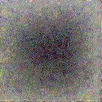
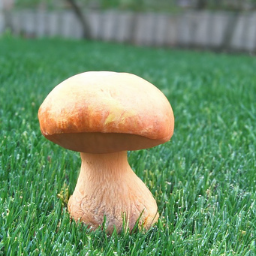
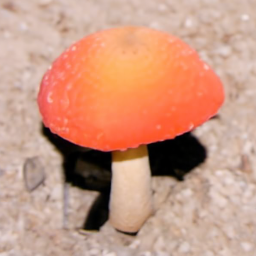
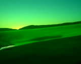

# CLIP Guided Diffusion
From [@crowsonkb](https://github.com/crowsonkb).

<p>
<a href="https://replicate.ai/afiaka87/clip-guided-diffusion" target="_blank"></a>    <a href="https://replicate.ai/afiaka87/pyglide" target="_blank"></a>
</p>

Disclaimer: I'm redirecting efforts to [pyglide](https://replicate.ai/afiaka87/pyglide) and may be slow to address bugs here.

I also recommend looking at [@crowsonkb's](https://github.com/crowsonkb) [v-diffusion-pytorch](https://github.com/crowsonkb/v-diffusion-pytorch).

See captions and more generations in the [Gallery](/images/README.md).

## Install

Requires [uv](https://docs.astral.sh/uv/getting-started/installation/).

```sh
git clone https://github.com/afiaka87/clip-guided-diffusion.git
cd clip-guided-diffusion
uv sync
```

## Run

`uv run cgd "Alien friend by Odilon Redo"`



- The path of the finished image is printed at the end. See [Speed](#speed) for how long that takes.
- `./outputs` will contain intermediate outputs, every 10 steps by default. Change this with `--save_frequency` / `-freq`.
- `current.png` will contain the current generation.
- The same `--seed` and arguments reproduce the image byte for byte on the same machine and library versions.
- Use `--save-as-gif` / `-gif` to save a high-quality GIF of every step and delete frames
- Use `--save-as-video` / `-mp4` to save a high-quality MP4 of every step and delete frames
- (optional) Provide **`--wandb_project <project_name>`** to enable logging intermediate outputs to wandb. Requires free account. URL to run will be provided in CLI - [example run](https://wandb.ai/dalle-pytorch-replicate/red_ball_cgd/reports/CLIP-Guided-Diffusion--VmlldzoxMDc1MjMz)
- `~/.cache/clip-guided-diffusion/` will contain downloaded checkpoints from OpenAI/Katherine Crowson.

## Usage - CLI

### Text to image generation

`--prompts` / `-txts`, or just pass the prompt first
`--image_size` / `-size`

`uv run cgd --image_size 256 "32K HUHD Mushroom"`



### Text to image generation (multiple prompts with weights)

- multiple prompts can be specified with the `|` character.
- you may optionally specify a weight for each prompt using a `:` character.
- e.g. `cgd --prompts "Noun to visualize:1.0|style:0.1|location:0.1|something you dont want:-0.1"`
- weights must not sum to 0

`uv run cgd "32K HUHD Mushroom|Green grass:-0.1"`

</img>

### Image prompts

`--image_prompts` / `-imgs` take paths or URLs, and the same `|` and `:` syntax. They can replace the text prompt or add to it.

`uv run cgd -imgs "images/goose_on_the_run.png"`

### CPU

- **Using a CPU will take a very long time** compared to using a GPU.

`uv run cgd --device cpu "Some text to be generated"`

### CUDA GPU

`uv run cgd "Theres no need to specify a device, it will be chosen automatically"`

### Steps

`--sample_steps` / `-n` (default: `30`)

- The number of model calls. Fewer is faster.
- `30` matches the original sampler on prompts held out from tuning. `20` is a third faster, but doubles the share of clipped pixels. Below `15` quality falls off quickly.
- `--uncond` defaults to `60`. Without a class label it needs the extra steps, see [Speed](#speed).

`--guidance_rate` / `-rate` (default: `0.08`)

- The most CLIP may move the image each step, relative to the noise. Higher follows the prompt harder, but saturates and clips the image.

### Original sampler

`--timestep_respacing` / `-respace`

- Runs the original guided-diffusion sampler instead of the fast one, with its original look, 16 cutouts and a random ImageNet class every step. Slow: `-respace 1000` takes minutes per image.
- A number of steps over the same schedule, e.g. `25`, `50`, `250`, `1000`. Fewer sacrifices accuracy/alignment for quicker runtime.
- prepending a number with `ddim` will use the ddim scheduler. e.g. `ddim25` will use the 25 timstep ddim scheduler. This method may be better at shorter timestep_respacing values.

### Existing image

#### `--init_image`/`-init`

- Start from an image instead of pure noise.

#### `--skip_timesteps`/`-skip`

How much of the schedule to skip. Higher stays closer to the image. Defaults to half of it, which is `500`.
This counts the 1000 steps of the full schedule, or the steps of `--timestep_respacing` when that is set.

- `-skip 500`
- `-respace 250 -skip 125`

#### (optional)`--init_scale`/`-is`

To enable a VGG perceptual loss after the blending, you must specify an `--init_scale` value. 1000 seems to work well.

```sh
uv run cgd "A mushroom in the style of Vincent Van Gogh" \
  --init_image "images/32K_HUHD_Mushroom.png" \
  --init_scale 1000 \
  --skip_timesteps 350
```

</img>

### Image size

- options: `64, 128, 256, 512 pixels (square)`
- Every size runs in 8 GB of VRAM. See [Speed](#speed) for the time and memory each one takes.
- Above 256x256 pixels per batch, the U-Net recomputes its activations during guidance instead of storing them. That takes about 1.5x the time per guided step and under half the memory, and it is automatic.
- `--uncond` uses the unconditional checkpoints, 256x256 and 512x512 only. It is less reliable than the default, because nothing but CLIP brings the subject.
- **Note about 64x64 with `--timestep_respacing`** the 64x64 checkpoint uses the cosine noise schedule, which requires different values for `--clip_guidance_scale` and `--tv_scale` in the original sampler. I recommend starting with `-cgs 5 -tvs 0.00001` and experimenting from around there. The default sampler needs no changes.
- For all other checkpoints, clip_guidance_scale seems to work well around 1000-2000 and tv_scale at 0, 100, 150 or 200

```sh
uv run cgd --init_image=images/32K_HUHD_Mushroom.png \
    --skip_timesteps=500 \
    --image_size 64 \
    "8K HUHD Mushroom"
```

</img>
_resized to 200 pixels for visibility_

```sh
uv run cgd --image_size 512 "8K HUHD Mushroom"
```

</img>

**New: Non-square Generations (experimental)**
Generate portrait or landscape images by specifying a number to offset the width and/or height.

- height and width must be multiples of an eighth of the image size: 8 at 64x64, 16 at 128x128, 32 at 256x256, 64 at 512x512
- may cause NaN/Inf errors.
- a positive offset will require more memory.
- a _negative_ offset uses less memory and is faster.

```sh
my_caption="a photo of beautiful green hills and a sunset, taken with a blackberry in 2004"
uv run cgd "$my_caption" \
    --image_size 128 \
    --width_offset 32 
```


## Speed

Wall clock for `uv run cgd`, including startup and model loading, on an RTX 2070 SUPER with 8 GB:

| Size | Sampler | Model calls | Time | Peak VRAM |
|---|---|---|---|---|
| 64 | default | 30 | 4.9 s | 1.6 GiB |
| 128 | default | 30 | 6.5 s | 2.4 GiB |
| 256 | default | 30 | 11.4 s | 5.3 GiB |
| 512 | default | 30 | 22.4 s | 4.1 GiB |
| 256 | `--uncond` | 60 | 20.0 s | 5.3 GiB |
| 512 | `--uncond` | 60 | 48.1 s | 4.1 GiB |
| 128 | `-respace 1000` | 1000 | 2 min 16 s | |
| 256 | `--uncond -respace 1000` | 1000 | 6 min | |

Quality was measured on prompts held out from tuning, as the ViT-B/16 CLIP similarity to the prompt. Guidance uses ViT-B/32, so this model is not the one being optimised.

- **Default, 128px, 12 prompts:** a tie with `-respace 1000`, 0.292 against 0.292 (difference 95% CI -0.018 to +0.016), with fewer clipped pixels, 6% against 7%. The look is different though, and any single image is not the same image.
- **`--uncond`, 256px, 6 prompts:** behind `-respace 1000`, 0.316 against 0.331 (difference 95% CI -0.040 to +0.014), and the original scored higher on 5 of the 6. Use the original sampler when an unconditional result matters more than the 18x speedup.

The original pipeline takes 1000 ancestral steps, because CLIP has to build the whole image while the U-Net follows a random class that changes every step. The default sampler in `cgd/sampling.py` gets there in 30 model calls:

- The U-Net is conditioned on the ImageNet class closest to your prompt, so it brings the subject and CLIP only steers.
- A second-order stochastic solver, DPM-Solver++(2M) SDE, covers the schedule in uniform logSNR steps.
- Guidance is capped relative to the noise, so it stays stable with steps 33x larger than the original's.
- Guidance only runs from 10% to 80% of the schedule, where it helps. The other steps also skip backpropagating through the U-Net, the most expensive part of guidance.
- CLIP sees 4 cutouts spanning 70-100% of the frame. At 128px the original's 16 cutouts were all the same full frame.
- `--uncond` has no class to bring the subject, so CLIP also sets the composition. Guidance starts right at the beginning of the schedule, and the sampler takes twice the steps so that does not overshoot.

Model loading is faster too: checkpoints are memory mapped instead of copied, nothing is randomly initialised just to be overwritten, and the ImageNet class features are cached on disk.

## Full Usage - Python

```python
# Initialize diffusion generator
from cgd.cgd import clip_guided_diffusion

cgd_generator = clip_guided_diffusion(
    prompts=["an image of a fox in a forest"],
    image_prompts=["image_to_compare_with_clip.png"],
    batch_size=1,
    clip_guidance_scale=1500,
    sat_scale=0,
    tv_scale=150,
    init_scale=1000,
    range_scale=50,
    image_size=256,
    class_cond=False,
    cutout_power=1.0,
    sample_steps=30,
    seed=0,
    skip_timesteps=400,
    init_image="image_to_blend_and_compare_with_vgg.png",
    clip_model_name="ViT-B/16",
    device="cuda",
    prefix_path="store_images/",
    wandb_project=None,
    wandb_entity=None,
    progress=True,
)
for batch_idx, image_path in cgd_generator:  # Yields each saved image. The last is the result.
    print(batch_idx, image_path)
```

## Full Usage - CLI

```sh
usage: cgd [-h] [--prompts PROMPTS] [--image_prompts IMAGE_PROMPTS]
           [--image_size {64,128,256,512}] [--init_image INIT_IMAGE]
           [--init_scale INIT_SCALE] [--skip_timesteps SKIP_TIMESTEPS]
           [--prefix PREFIX] [--checkpoints_dir CHECKPOINTS_DIR]
           [--batch_size BATCH_SIZE]
           [--clip_guidance_scale CLIP_GUIDANCE_SCALE] [--tv_scale TV_SCALE]
           [--range_scale RANGE_SCALE] [--sat_scale SAT_SCALE] [--seed SEED]
           [--save_frequency SAVE_FREQUENCY]
           [--timestep_respacing TIMESTEP_RESPACING]
           [--sample_steps SAMPLE_STEPS] [--guidance_rate GUIDANCE_RATE]
           [--num_cutouts NUM_CUTOUTS] [--cutout_power CUTOUT_POWER]
           [--clip_model CLIP_MODEL] [--uncond] [--device DEVICE]
           [--wandb_project WANDB_PROJECT] [--wandb_entity WANDB_ENTITY]
           [--height_offset HEIGHT_OFFSET] [--width_offset WIDTH_OFFSET]
           [--quiet] [--save-as-gif] [--save-as-video]
           [prompt]

CLIP Guided Diffusion: generate images from text and image prompts.

positional arguments:
  prompt                the prompt/s to reward, same format as --prompts
                        (default: )

options:
  -h, --help            show this help message and exit
  --prompts, -txts PROMPTS
                        the prompt/s to reward paired with weights. e.g. 'My
                        text:0.5|Other text:-0.5' (default: )
  --image_prompts, -imgs IMAGE_PROMPTS
                        the image prompt/s to reward paired with weights. e.g.
                        'img1.png:0.5|img2.png:-0.5' (default: )
  --image_size, -size {64,128,256,512}
                        Diffusion image size. (default: 128)
  --init_image, -init INIT_IMAGE
                        Start from this image instead of pure noise. (default:
                        )
  --init_scale, -is INIT_SCALE
                        (optional) Perceptual loss scale for init image.
                        (default: 0)
  --skip_timesteps, -skip SKIP_TIMESTEPS
                        How much of the schedule to skip with an init image.
                        Higher stays closer to it. 0 skips half. (default: 0)
  --prefix, -dir PREFIX
                        output directory (default: outputs)
  --checkpoints_dir, -ckpts CHECKPOINTS_DIR
                        Path subdirectory containing checkpoints. (default:
                        ~/.cache/clip-guided-diffusion)
  --batch_size, -bs BATCH_SIZE
                        the batch size (default: 1)
  --clip_guidance_scale, -cgs CLIP_GUIDANCE_SCALE
                        Scale for CLIP spherical distance loss. Values will
                        need tinkering for different settings. (default: 1000)
  --tv_scale, -tvs TV_SCALE
                        Controls the smoothness of the final output. (default:
                        150.0)
  --range_scale, -rs RANGE_SCALE
                        Controls how far out of RGB range values may get.
                        (default: 50.0)
  --sat_scale, -sats SAT_SCALE
                        Controls how much saturation is allowed. Used for
                        ddim. From @nshepperd. (default: 0.0)
  --seed, -seed SEED    Random number seed (default: 0)
  --save_frequency, -freq SAVE_FREQUENCY
                        Save a frame every n steps. The final image is always
                        saved. Defaults to 10, or 1 with --save-as-gif/--save-
                        as-video. (default: None)
  --timestep_respacing, -respace TIMESTEP_RESPACING
                        Use the original guided-diffusion sampler with this
                        respacing, e.g. 1000 or ddim50. Much slower. (default:
                        None)
  --sample_steps, -n SAMPLE_STEPS
                        Model calls for the fast sampler. Defaults to 30, or
                        60 with --uncond. Ignored when --timestep_respacing is
                        set. (default: None)
  --guidance_rate, -rate GUIDANCE_RATE
                        Fast sampler guidance strength, as the most CLIP may
                        move each step relative to the noise. Higher follows
                        the prompt harder but saturates. (default: 0.08)
  --num_cutouts, -cutn NUM_CUTOUTS
                        Number of randomly cut patches to distort from
                        diffusion. Defaults to 4, or 16 with
                        --timestep_respacing. (default: None)
  --cutout_power, -cutpow CUTOUT_POWER
                        Cutout size power (default: 1.0)
  --clip_model, -clip CLIP_MODEL
                        clip model name. Should be one of: ('ViT-B/16',
                        'ViT-B/32', 'RN50', 'RN101', 'RN50x4', 'RN50x16',
                        'ViT-L/14') or a checkpoint filename ending in `.pt`
                        (default: ViT-B/32)
  --uncond, -uncond     Use finetuned unconditional checkpoints from OpenAI
                        (256px) and Katherine Crowson (512px) (default: False)
  --device, -dev DEVICE
                        Device to use. Either cpu or cuda. (default: )
  --wandb_project, -proj WANDB_PROJECT
                        Name W&B will use when saving results. e.g.
                        `--wandb_project "my_project"` (default: None)
  --wandb_entity, -ent WANDB_ENTITY
                        (optional) Name of W&B team/entity to log to.
                        (default: None)
  --height_offset, -ht HEIGHT_OFFSET
                        Height offset for image (default: 0)
  --width_offset, -wd WIDTH_OFFSET
                        Width offset for image (default: 0)
  --quiet, -q           Suppress output. (default: False)
  --save-as-gif, -gif   Save output as high-quality GIF using ffmpeg. Deletes
                        individual frames. (default: False)
  --save-as-video, -mp4
                        Save output as high-quality MP4 video using ffmpeg.
                        Deletes individual frames. (default: False)
```

## Development

```sh
git clone https://github.com/afiaka87/clip-guided-diffusion.git
cd clip-guided-diffusion
uv sync
```

### Run integration tests

- Most tests run on a real GPU with the real models. Give them a free one: they fail with a genuine out of memory error if another process holds the VRAM.

```sh
uv run pytest
```
