# CLIP Guided Diffusion
From [@crowsonkb](https://github.com/crowsonkb).

<p>
<a href="https://replicate.com/afiaka87/clip-guided-diffusion" target="_blank"></a>    <a href="https://replicate.com/afiaka87/pyglide" target="_blank"></a>
</p>

The Replicate demo runs the version from October 2022, which has none of the speedups, models or options this README measures.

Disclaimer: I'm redirecting efforts to [pyglide](https://replicate.com/afiaka87/pyglide) and may be slow to address bugs here.

I also recommend looking at [@crowsonkb's](https://github.com/crowsonkb) [v-diffusion-pytorch](https://github.com/crowsonkb/v-diffusion-pytorch).

See more generations, each with its command, in the [Gallery](/images/README.md).

## Install

Requires [uv](https://docs.astral.sh/uv/getting-started/installation/).

```sh
git clone https://github.com/afiaka87/clip-guided-diffusion.git
cd clip-guided-diffusion
uv sync
```

## Run

`uv run cgd -gif -freq 3 -size 256 -clip ViT-B/32+PE-Core-B-16 -n 90 -gl 0.99 "A monarch butterfly on a purple flower"`

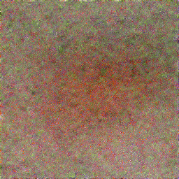

That is the classic pipeline: an ImageNet model steered by CLIP, with no extra dependencies to download. It conditions the model on the ImageNet class closest to the prompt, and prints it: `monarch butterfly`, here. `uv run cgd -gif "A monarch butterfly on a purple flower"` works too. The options were chosen by eye for a better image, and most examples here use them:

- `-size 256`, twice the default size.
- `-n 90`, three times the default steps.
- `-clip ViT-B/32+PE-Core-B-16`, an [ensemble](#ensembles), the one option that measurably improves the image.
- `-gl 0.99`, which [holds back](#other-options) the part of CLIP's update that would clip, for natural colour.
- `-freq 3`, which keeps every third step, so the GIF stays small.

That took 37 s on an RTX 2070 SUPER. For the best images this repo makes, use [a modern backbone](#modern-backbones), here in 48 s:

`uv run cgd -bb sd-turbo -gif "A monarch butterfly on a purple flower"`


Every GIF in this README is its command's real output, with the default seed. The one exception is the [upscaling](#upscaling) comparison, which is made from a command's two outputs.

- The path of the finished image is printed at the end. See [Speed](#speed) for how long that takes.
- `./outputs` will contain intermediate outputs, every 10 steps by default. Change this with `--save_frequency` / `-freq`.
- `current.png` will contain the current generation.
- The same `--seed` and arguments reproduce the image byte for byte on the same machine and library versions.
- Use `--save-as-gif` / `-gif` to save a high-quality GIF of every step, at 10 frames a second, and delete the frames. The frames of the batch's first image are in `outputs/<prompt>/00/`, and its GIF is `outputs/<prompt>/00.gif`.
- Use `--save-as-video` / `-mp4` to save a high-quality MP4 of every step the same way, as `outputs/<prompt>/00.mp4`.
- The classic pipeline's animation shows its estimate of the finished image at each step, so it runs from a blur to the image. A backbone's shows each step of CLIP reshaping an image that is finished from the first frame, and ends on the image from the full decoder.
- Animation exports require FFmpeg. Frames stream to the encoder without buffering the whole
  animation in memory. MP4 uses H.264/yuv420p, padding odd dimensions for playback compatibility.
  Exports replace the destination only after successful encoding; failures preserve source
  frames and any previous export. The final image remains available as `current.png`.
- (optional) Provide **`--wandb_project <project_name>`** to enable logging intermediate outputs to wandb. Requires free account. URL to run will be provided in CLI - [example run](https://wandb.ai/dalle-pytorch-replicate/red_ball_cgd/reports/CLIP-Guided-Diffusion--VmlldzoxMDc1MjMz)
- `~/.cache/clip-guided-diffusion/` will contain downloaded checkpoints from OpenAI/Katherine Crowson.

## Usage - CLI

### Text to image generation

- `--prompts` / `-txts`, or just pass the prompt first
- `--image_size` / `-size`

`uv run cgd -gif -freq 3 -size 256 -clip ViT-B/32+PE-Core-B-16 -n 90 -gl 0.99 "A great grey owl perched on a branch"`

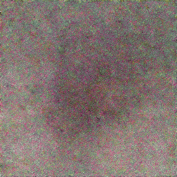

### Text to image generation (multiple prompts with weights)

- multiple prompts can be specified with the `|` character.
- you may optionally specify a weight for each prompt using a `:` character.
- e.g. `uv run cgd --prompts "Noun to visualize:1.0|style:0.1|location:0.1|something you dont want:-0.1"`
- weights must not sum to 0

`uv run cgd -gif -freq 3 -size 256 -clip ViT-B/32+PE-Core-B-16 -n 90 -gl 0.99 "A steam locomotive crossing a stone bridge"`

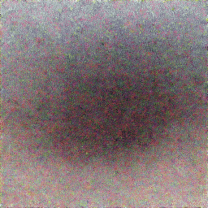

A negative weight takes the smoke away:

`uv run cgd -gif -freq 3 -size 256 -clip ViT-B/32+PE-Core-B-16 -n 90 -gl 0.99 "A steam locomotive crossing a stone bridge|smoke:-0.5"`

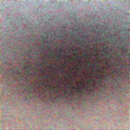

### Image prompts

`--image_prompts` / `-imgs` take paths or URLs, and the same `|` and `:` syntax. They can replace the text prompt or add to it.

`uv run cgd -gif -freq 3 -size 256 -clip ViT-B/32+PE-Core-B-16 -n 90 -gl 0.99 -imgs "images/goose_on_the_run.png"`

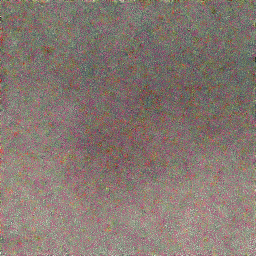

The prompt is [this goose](images/goose_on_the_run.png), a generation from 2021. The ImageNet class comes from the image prompts too: `goose`, here.

### CPU

- **Using a CPU takes much longer** than using a GPU. This took 145 s on a Ryzen 9 3900X, and 15 s without `--device cpu` on an RTX 2070 SUPER.
- The CPU runs the diffusion model at full precision, where the GPU uses half, and the same seed gives a different image on each.

`uv run cgd --device cpu -gif -freq 2 -clip ViT-B/32+PE-Core-B-16 -n 60 -gl 0.99 "A wooden cabin in a snowy forest"`

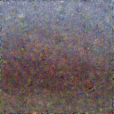

### CUDA GPU

There's no need to specify a device: without `--device`, it uses CUDA whenever PyTorch can.

`uv run cgd -gif -freq 3 -size 256 -clip ViT-B/32+PE-Core-B-16 -n 90 -gl 0.99 "A wooden cabin in a snowy forest"`

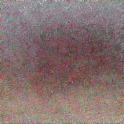

### Steps

`--sample_steps` / `-n` (default: `30`)

- The number of model calls. Fewer is faster.
- `30` matches the original sampler on prompts held out from tuning. `20` is a third faster, but doubles the share of clipped pixels. Below `15` quality falls off quickly.
- `--uncond` defaults to `60`. Without a class label it needs the extra steps, see [Speed](#speed).

`--guidance_rate` / `-rate` (default: `0.08`)

- The most CLIP may move the image each step, relative to the noise. Higher follows the prompt harder, but saturates and clips the image.

### Original sampler

`--timestep_respacing` / `-respace`

- Runs the original guided-diffusion sampler instead of the fast one, with its original look, 16 cutouts and a random ImageNet class every step. Slow: `-respace 1000` takes minutes per image.
- A number of steps over the same schedule, e.g. `25`, `50`, `250`, `1000`. Fewer sacrifices accuracy/alignment for quicker runtime.
- prepending a number with `ddim` will use the ddim scheduler. e.g. `ddim25` will use the 25 timestep ddim scheduler. This method may be better at shorter timestep_respacing values.

### Existing image

#### `--init_image`/`-init`

- Start from an image instead of pure noise.

#### `--skip_timesteps`/`-skip`

How much of the schedule to skip. Higher stays closer to the image. Defaults to half of it, which is `500`.
This counts the 1000 steps of the full schedule, or the steps of `--timestep_respacing` when that is set.

- `-skip 500`
- `-respace 250 -skip 125`

#### (optional)`--init_scale`/`-is`

Adds a VGG perceptual loss ([LPIPS](https://github.com/richzhang/PerceptualSimilarity)) between the image and the init image, which keeps the init's composition. 1000 seems to work well. In this example `0` sank the cap into tall grass and lost the stem, `3000` kept the fence behind the mushroom but barely turned it red, and `1000` sits between them.

```sh
uv run cgd -gif -freq 3 -size 256 -clip ViT-B/32+PE-Core-B-16 -n 90 -gl 0.99 \
  --init_image images/32K_HUHD_Mushroom.png \
  --init_scale 1000 \
  --skip_timesteps 300 \
  "A red mushroom in the grass"
```

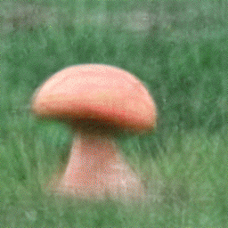

The init image is [this mushroom](images/32K_HUHD_Mushroom.png), a generation from 2021. Skipping 300 of the 1000 steps leaves 66 of the 90 model calls, so the GIF has 23 frames.

### Image size

- options: `64, 128, 256, 512 pixels (square)`, or any multiple of 8 with [`--backbone`](#modern-backbones)
- Every size runs in 8 GB of VRAM with the default CLIP model. See [Speed](#speed) for the time and memory each one takes, and [CLIP models](#clip-models) for the models that need more.
- Above 256x256 pixels per batch, the U-Net recomputes its activations during guidance instead of storing them. That takes about 1.5x the time per guided step and under half the memory, and it is automatic.
- `--uncond` uses the unconditional checkpoints, 256x256 and 512x512 only. It is less reliable than the default, because nothing but CLIP brings the subject.
- **Note about 64x64 with `--timestep_respacing`** the 64x64 checkpoint uses the cosine noise schedule, which requires different values for `--clip_guidance_scale` and `--tv_scale` in the original sampler. I recommend starting with `-cgs 5 -tvs 0.00001` and experimenting from around there. The default sampler needs no changes.
- For all other checkpoints, clip_guidance_scale seems to work well around 1000-2000 and tv_scale at 0, 100, 150 or 200

```sh
uv run cgd -gif --init_image=images/32K_HUHD_Mushroom.png \
    --skip_timesteps=500 \
    --image_size 64 \
    "8K HUHD Mushroom"
```

</img>
_resized to 200 pixels for visibility_

```sh
uv run cgd -gif -freq 2 -size 512 -clip ViT-B/32+PE-Core-B-16 -n 60 -gl 0.99 "A sailboat on a calm lake at sunset"
```

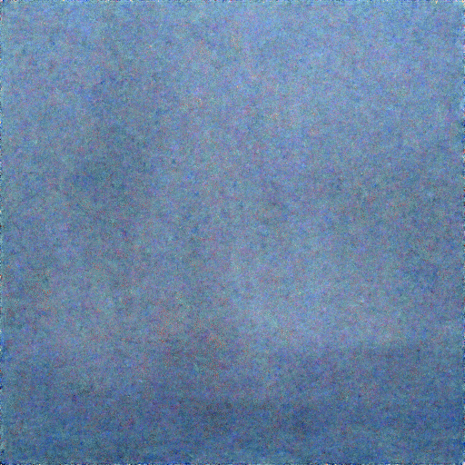

`-n 60` instead of 90, because each step costs more at 512. That took 53 s.

**Non-square generations**

Generate portrait or landscape images by specifying a number to offset the width and/or height, with `--width_offset` / `-wd` and `--height_offset` / `-ht`.

- height and width must be multiples of an eighth of the image size: 8 at 64x64, 16 at 128x128, 32 at 256x256, 64 at 512x512. With [`--backbone`](#modern-backbones), any multiple of 8.
- None of 12 runs from 80x64 to 640x512, on both samplers, produced NaN or Inf. By eye, the default sampler's images were as clean as square ones. `-respace ddim50` gave saturated, broken images, but it did that at square sizes too.
- a positive offset will require more memory.
- a _negative_ offset uses less memory and is faster.

```sh
uv run cgd -gif -freq 3 -size 256 -clip ViT-B/32+PE-Core-B-16 -n 90 -gl 0.99 \
    --width_offset 128 \
    "A castle on a hill at sunset"
```

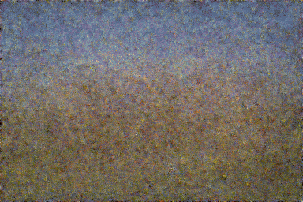

## Modern backbones

`--backbone` / `-bb`

`uv run cgd -bb sd-turbo -gif "A red fox in the snow"`


The ImageNet models only learned ImageNet, and CLIP cannot supply what a model never learned. With `-bb` a modern one-step model draws the image, and CLIP corrects it by optimising the model's starting noise for 50 steps ([ReNO](https://arxiv.org/abs/2406.04312)). There is no solver to tune, the noise stays on the model's prior, and the same `--seed` still reproduces the image byte for byte.

| `-bb` | Size | Plain, `-iters 0` | With CLIP | Download | License |
|---|---|---|---|---|---|
| `sd-turbo` (start here) | 512 (default) | 6.4 s, 2.5 GiB | 27.2 s, 3.2 GiB | 2.5 GB | [Stability Community](https://stability.ai/community-license-agreement). Commercial use needs registration and ends above USD 1M revenue |
| `vega` | 768 | 9.5 s, 2.9 GiB | 36.0 s, 3.6 GiB | 3.6 GB | Apache-2.0 |
| | 1024 (default) | 9.9 s, 3.9 GiB | 49.8 s, 4.7 GiB | | |
| `sdxl-lightning` | 768 | 10.4 s, 6.3 GiB | 57.6 s, 7.0 GiB | 12 GB | [OpenRAIL++](https://huggingface.co/stabilityai/stable-diffusion-xl-base-1.0/blob/main/LICENSE.md) |
| | 1024 (default) | 10.2 s, 7.3 GiB | Out of memory on 8 GB | | |

Wall clock for one image with `cgd`, including startup and loading with the weights already on disk, and peak VRAM, on an RTX 2070 SUPER with 8 GB and nothing else on it. With CLIP means the defaults, `ViT-B/32+PE-Core-B-16` and `-aes 0.05`. `sdxl-lightning` at its default 1024 needs `-size 768` on 8 GB, or `-iters 0`, which skips CLIP. Even a single `-clip ViT-B/32` runs out of memory there. It should fit 12 GB with CLIP, but nothing has been run on an RTX 4070. Weights go to the Hugging Face cache.

How the images score, on 12 prompts held out from tuning, 3 seeds on SD-Turbo and 4 on ADM. The first three columns are CLIP similarity to the prompt on models that did not guide the image, and the last is a predicted human rating from 1 to 10 made by a [ViT-B/16 predictor](https://github.com/crowsonkb/simulacra-aesthetic-models) that also did not guide it.

| | `ViT-B/16` | `ViT-H-14-quickgelu` | `ViT-L-16-SigLIP2-256` | Rating |
|---|---|---|---|---|
| Default ADM, 128 | 0.293 | 0.289 | 0.109 | 4.79 |
| ADM, 128, with an [ensemble](#ensembles) | 0.308 | 0.313 | 0.127 | 4.85 |
| `-bb sd-turbo -iters 0` | 0.342 | 0.373 | 0.184 | 6.48 |
| `-bb sd-turbo -aes 0` | 0.357 | 0.385 | 0.193 | 6.35 |
| `-bb sd-turbo` | 0.350 | 0.384 | 0.194 | 6.90 |

The swap is by far the biggest gain measured here, over four times the best change that stays on ADM. Size explains little of it: ADM at 512 gains 0.025 ± 0.029 over ADM at 128 on one seed, against 0.081 for the swap. These models resize to about 224 pixels, so they cannot see fine detail, and no person has rated these images.

At 768, on one seed and with `-aes 0.1` on the whole frame, CLIP added 0.010 to `vega`, which still scored 0.005 below `sd-turbo` at 512 and looks softer and less saturated. `sdxl-lightning` was the sharpest by eye, and CLIP added nothing measurable to it, so `-iters 0` is its best setting unless you want the [aesthetic term](#aesthetic). At 1024 only time and memory were measured.

- `--iterations` / `-iters` (default `50`): `100` takes twice as long and adds 0.002. `200` adds 0.006 on one seed, and starts to look adversarial. `25` loses 0.010.
- `--full_decoder` / `-fulldec`: backpropagates through the real decoder. No better by score (0.001 ± 0.003), for twice the time and 1 GiB more at 512.
- `--render_steps` / `-steps`: more model calls for the final image. `4` scored 0.006 lower on one seed, so the default stays at `1`.
- The prompt conditions the model as well as CLIP, except for negative weights, which only CLIP sees.

## Speed

Wall clock for `uv run cgd`, including startup and model loading, on an RTX 2070 SUPER with 8 GB:

| Size | Sampler | Model calls | Time | Peak VRAM |
|---|---|---|---|---|
| 64 | default | 30 | 4.9 s | 1.6 GiB |
| 128 | default | 30 | 6.5 s | 2.4 GiB |
| 256 | default | 30 | 11.4 s | 5.3 GiB |
| 512 | default | 30 | 22.4 s | 4.1 GiB |
| 256 | `--uncond` | 60 | 20.0 s | 5.3 GiB |
| 512 | `--uncond` | 60 | 48.1 s | 4.1 GiB |
| 128 | `-respace 1000` | 1000 | 2 min 16 s | |
| 256 | `--uncond -respace 1000` | 1000 | 6 min | |

Quality was measured on prompts held out from tuning, as the ViT-B/16 CLIP similarity to the prompt. Guidance uses ViT-B/32, so this model is not the one being optimised.

- **Default, 128px, 12 prompts:** a tie with `-respace 1000`, 0.292 against 0.292 (difference 95% CI -0.018 to +0.016), with fewer clipped pixels, 6% against 7%. The look is different though, and any single image is not the same image.
- **`--uncond`, 256px, 6 prompts:** behind `-respace 1000`, 0.316 against 0.331 (difference 95% CI -0.040 to +0.014), and the original scored higher on 5 of the 6. Use the original sampler when an unconditional result matters more than the 18x speedup.

The original pipeline takes 1000 ancestral steps, because CLIP has to build the whole image while the U-Net follows a random class that changes every step. The default sampler in `cgd/sampling.py` gets there in 30 model calls:

- The U-Net is conditioned on the ImageNet class closest to your prompt, so it brings the subject and CLIP only steers.
- A second-order stochastic solver, DPM-Solver++(2M) SDE, covers the schedule in uniform logSNR steps.
- Guidance is capped relative to the noise, so it stays stable with steps 33x larger than the original's.
- Guidance only runs from 10% to 80% of the schedule, where it helps. The other steps also skip backpropagating through the U-Net, the most expensive part of guidance.
- CLIP sees 4 random cutouts. At 128px they span 70-100% of the frame, where the original's 16 cutouts were all the same full frame. At 512px they span 44-100%, because a cutout is never smaller than CLIP's 224px input. See [Cutouts](#cutouts).
- `--uncond` has no class to bring the subject, so CLIP also sets the composition. Guidance starts right at the beginning of the schedule, and the sampler takes twice the steps so that does not overshoot.

Model loading is faster too: checkpoints are memory mapped instead of copied, nothing is randomly initialised just to be overwritten, and the ImageNet class features are cached on disk.

## CLIP models

`--clip_model` / `-clip` (default: `ViT-B/32`)

`uv run cgd -gif -freq 3 -clip PE-Core-L-14-336 -size 256 -n 90 -gl 0.99 "A red fox in the snow"`

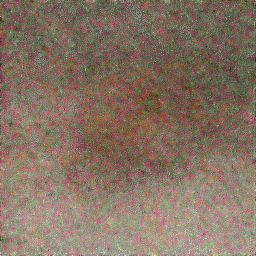

Join models with `+` to guide with all of them, see [Ensembles](#ensembles).

OpenAI's `RN50`, `RN101`, `RN50x4`, `RN50x16`, `ViT-B/16`, `ViT-B/32` and `ViT-L/14` are still there. These are the newer ones, from [open_clip](https://github.com/mlfoundations/open_clip): Meta's [PE-Core](https://arxiv.org/abs/2504.13181) and Google's [SigLIP 2](https://arxiv.org/abs/2502.14786).

| Model | ImageNet zero-shot | Input | Download | Load |
|---|---|---|---|---|
| `ViT-B/32` (default) | 63.3% | 224 | 0.3 GiB | 0.8 s |
| `PE-Core-B-16` | 78.4% | 224 | 1.7 GiB | 2.6 s |
| `ViT-L-16-SigLIP2-256` | 82.5% | 256 | 3.3 GiB | 3.9 s |
| `PE-Core-L-14-336` | 83.5% | 336 | 2.5 GiB | 3.9 s |
| `ViT-SO400M-16-SigLIP2-384` | 84.1% | 384 | 4.2 GiB | 4.7 s |
| `ViT-gopt-16-SigLIP2-384` | 85.0% | 384 | 7.0 GiB | 8.5 s |
| `PE-Core-bigG-14-448` | 85.4% | 448 | 9.0 GiB | 13.4 s |

Accuracy is as published by open_clip and Meta. Weights download to `~/.cache/clip-guided-diffusion/clip/` the first time a model is used. Loading takes about the download size in system RAM.

The first run of each model also encodes the ImageNet class names, once, on the CPU: 2 minutes for `ViT-gopt-16-SigLIP2-384`, 2.5 for `PE-Core-bigG-14-448`, on a Ryzen 9 3900X.

### Which one to use

Use the pair `ViT-B/32+PE-Core-B-16`, see [Ensembles](#ensembles). Of the single models, `PE-Core-B-16` looked best: it takes the same VRAM as the default and about 1.3 s more per image, it was the only model to beat `ViT-B/32` with all three judges at 128 on seed 0, and at 256 it does as well as the bigger models. Over 4 more seeds at 128 that lead shrank to a tie, +0.001 ± 0.015, so on its own it is not worth the download.

Higher ImageNet accuracy did not make a better guide. `ViT-gopt-16-SigLIP2-384` and `PE-Core-bigG-14-448` tie or trail the default by score, at 5x to 15x the time at 128. By eye they draw the most photographic images, which can work against the prompt: `ViT-gopt-16-SigLIP2-384` at fp32 turned "a pencil sketch of an old man with a beard" into a photo of a bird. `ViT-SO400M-16-SigLIP2-384` at fp32 wrote nonsense text across "a plate of sushi on a black slate".

`ViT-B/32` stays the default because it is the fastest and its gradient is by far the smoothest.

Each cell is the change in CLIP similarity to the prompt against `ViT-B/32`, on 12 prompts held out from tuning with seed 0, then how many of the 12 improved. Three models judged the images, and a model never grades its own guidance, hence the empty cells. `ViT-B/16` is close kin to `ViT-B/32`, so it favours it. `-rate` was tuned on `ViT-B/32` and not retuned per model. The 95% interval on a difference is about ±0.03, so most of these are ties.

128:

| Model | Precision | `ViT-B/16` | `ViT-H-14-quickgelu` | `ViT-L-16-SigLIP2-256` |
|---|---|---|---|---|
| `PE-Core-B-16` | fp32 | +0.014 (8) | +0.016 (10) | +0.025 (8) |
| `ViT-L-16-SigLIP2-256` | fp32 | -0.019 (5) | +0.010 (5) | |
| | `-fp16` | -0.008 (5) | +0.007 (6) | |
| `PE-Core-L-14-336` | fp32 | -0.017 (4) | +0.001 (7) | +0.001 (5) |
| | `-fp16` | -0.011 (5) | +0.017 (9) | +0.011 (8) |
| `ViT-SO400M-16-SigLIP2-384` | fp32 | -0.010 (3) | +0.005 (6) | +0.017 (8) |
| | `-fp16` | -0.019 (4) | -0.009 (4) | -0.008 (5) |
| `ViT-gopt-16-SigLIP2-384` | fp32 | -0.025 (3) | -0.012 (6) | -0.017 (6) |
| | `-fp16` | -0.031 (2) | +0.004 (7) | -0.003 (7) |
| `PE-Core-bigG-14-448` | `-fp16` | -0.022 (6) | -0.001 (8) | -0.001 (7) |

256:

| Model | Precision | `ViT-B/16` | `ViT-H-14-quickgelu` | `ViT-L-16-SigLIP2-256` |
|---|---|---|---|---|
| `PE-Core-B-16` | fp32 | -0.002 (4) | +0.018 (7) | +0.031 (12) |
| `PE-Core-L-14-336` | fp32 | -0.004 (5) | +0.020 (9) | +0.032 (10) |
| `ViT-SO400M-16-SigLIP2-384` | fp32 | -0.021 (3) | +0.018 (8) | +0.035 (11) |
| `ViT-gopt-16-SigLIP2-384` | `-fp16 -cutn 2` | -0.041 (3) | -0.014 (5) | -0.003 (5) |

`-fp16` moved scores in both directions, by less than the noise, which is why it counts as no measurable difference.

### Time and VRAM

Time to sample one image and peak VRAM, the median of 3 prompts on an RTX 2070 SUPER with 8 GB and nothing else on it. Add the load time above, once per run. `~` marks a size that ran out of memory on this card: the number is what it should need, projected from the models that ran at that size, and has not been measured.

| Model | Precision | 128 | 256 | 512 |
|---|---|---|---|---|
| `ViT-B/32` | | 2.7 s, 2.3 GiB | 7.5 s, 5.3 GiB | 18.7 s, 4.1 GiB |
| `PE-Core-B-16` | fp32 | 4.0 s, 2.4 GiB | 8.8 s, 5.3 GiB | 20.0 s, 4.1 GiB |
| | `-fp16` | 3.3 s, 2.2 GiB | 8.2 s, 5.2 GiB | 19.4 s, 4.0 GiB |
| `ViT-L-16-SigLIP2-256` | fp32 | 7.5 s, 3.3 GiB | 12.5 s, 6.3 GiB | 23.8 s, 4.9 GiB |
| | `-fp16` | 4.2 s, 2.6 GiB | 9.2 s, 5.6 GiB | 20.5 s, 4.4 GiB |
| `PE-Core-L-14-336` | fp32 | 16.0 s, 3.7 GiB | 20.7 s, 6.6 GiB | 32.3 s, 4.9 GiB |
| | `-fp16` | 7.8 s, 2.8 GiB | 12.7 s, 5.8 GiB | 24.0 s, 4.4 GiB |
| `ViT-SO400M-16-SigLIP2-384` | fp32 | 19.3 s, 4.2 GiB | 24.1 s, 7.1 GiB | 35.4 s, 5.4 GiB |
| | `-fp16` | 7.8 s, 3.1 GiB | 12.7 s, 6.0 GiB | 24.0 s, 4.6 GiB |
| `ViT-gopt-16-SigLIP2-384` | fp32 | 42.0 s, 7.2 GiB | ~10 GiB | ~8.5 GiB |
| | `-fp16` | 13.7 s, 4.6 GiB | ~7.5 GiB | 30.0 s, 5.9 GiB |
| `PE-Core-bigG-14-448` | fp32 | ~11.5 GiB | ~14.5 GiB | ~13 GiB |
| | `-fp16` | 35.3 s, 6.6 GiB | ~9.5 GiB | ~8 GiB |

256 needs more than 512 because 512 is the size where the U-Net starts recomputing its activations, see [Image size](#image-size). PyTorch holds on to about 0.1 GiB beyond the peak at 128 and 256, and up to 0.9 GiB at 512, so leave that free too.

| VRAM | What fits |
|---|---|
| 8 GB | Everything through `ViT-SO400M-16-SigLIP2-384`, at every size, though that one at 256 fp32 needs a nearly empty card. `ViT-gopt-16-SigLIP2-384` at 128, at 512 with `-fp16`, or at 256 with `-fp16 -cutn 2` (31.5 s, 7.3 GiB). `PE-Core-bigG-14-448` at 128 with `-fp16`. |
| 12 GB (estimated) | `ViT-gopt-16-SigLIP2-384` at every size. `PE-Core-bigG-14-448` at every size with `-fp16`. |
| 16 GB (estimated) | Everything, at every size. |

### `--clip_fp16` / `-fp16`

Runs the vision tower of a PE-Core or SigLIP2 model at half precision: up to 3x faster and half the CLIP VRAM. fp32 stays the default because it is the exact computation, but use `-fp16` whenever time or VRAM matters: it made no measurable difference to quality, see [Which one to use](#which-one-to-use). It saves little on `PE-Core-B-16`, and that one combination has no quality measurement.

The gradient does change. Its cosine similarity to the fp32 gradient varied by model and image, over 3 images: 0.11 to 0.42 for `ViT-gopt-16-SigLIP2-384`, 0.19 to 0.996 for `PE-Core-L-14-336`, 0.83 to 0.93 for `PE-Core-B-16`, 0.95 to 0.9995 for `ViT-L-16-SigLIP2-256` and 0.99 for `ViT-SO400M-16-SigLIP2-384`. That says less than it seems to, because these gradients are chaotic: noise of 1 part in 2048 on the input image, without changing the precision at all, moves the fp32 gradient to a cosine of 0.52 to 0.79 for `ViT-gopt-16-SigLIP2-384` and 0.39 to 0.97 for `PE-Core-L-14-336`. Guidance averages over cutouts and steps, so it follows what stays consistent. `ViT-B/32`, by comparison, stays at 0.999 under the same noise. OpenAI's models always run at half precision, and at 0.9997 to 0.9999 lose nothing by it.

## What improves the image

Everything here was measured against the default on 12 prompts held out from tuning, as the change in CLIP similarity to the prompt pooled over the three models above, with its 95% interval across prompts, and how many of the 12 improved. ADM at 128 over 4 seeds unless noted, and SD-Turbo at 512 over 3. A difference smaller than the interval is a tie. Most options are off because they lost. They stay because a score is not an image: these models cannot see fine detail, and they reward caption match, not looks. Full evidence is in [the report](<reports/CLIP guided diffusion quality improvements.md>).

### Ensembles

`uv run cgd -gif -freq 3 -size 256 -clip ViT-B/32+PE-Core-B-16 -n 90 -gl 0.99 "A red fox in the snow"`

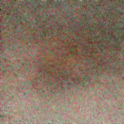

The one change that clearly helps ADM, and the default with `-bb`. Each model backpropagates on its own, so only one model's activations are in memory at a time.

| Size | Change | Default | Ensemble |
|---|---|---|---|
| 128 | +0.019 ± 0.015 (10), 4 seeds | 2.9 s, 2.3 GiB | 5.9 s, 2.7 GiB |
| 256 | +0.015 ± 0.014 (7), 2 seeds | 7.8 s, 5.3 GiB | 10.7 s, 5.6 GiB |
| 512 | +0.012 ± 0.015 (9), 1 seed | 18.8 s, 4.1 GiB | 21.6 s, 4.4 GiB |

That includes loading both models for every image, which a single `cgd` run only does once. `PE-Core-B-16` on its own only ties (+0.001 ± 0.015), so it takes the pair. It is not the ADM default because that would change every existing seed's image, and it needs a 1.7 GiB download. Adding `-solver er-sde` keeps the gain and makes it steadier: +0.017 ± 0.008, and all 12 prompts improved.

### Keep the best of several seeds

`--candidates` / `-best`

`uv run cgd -best 4 -gif "A red fox in the snow"`

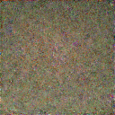

Runs that many seeds from `--seed`, and reports the one that `ViT-B/16` and `ViT-L-16-SigLIP2-256` prefer. Here they picked seed 0, the image `--seed 0` gives on its own. Each candidate's frames go in `outputs/seed_<n>/`, and only the pick's become a GIF or video. Takes that many times as long, and the judges run on the CPU. Picked that way and scored by `ViT-H-14-quickgelu`, which did not pick, against the average candidate: ADM best of 4 gains +0.015 ± 0.007 (11), or +0.025 ± 0.011 (12) with the ensemble. SD-Turbo best of 3 gains +0.005 ± 0.005 (8), so it matters much less there.

### Upscaling

`--upscale` / `-up`

`uv run cgd -gif -freq 3 -up -clip ViT-B/32+PE-Core-B-16 -n 90 -gl 0.99 "A monarch butterfly on a purple flower"`

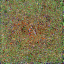


Also saves a copy of the finished image 4x larger, made with [Real-ESRGAN x4plus](https://github.com/xinntao/Real-ESRGAN), a 64 MB download. It goes in the frames' folder, `outputs/A_monarch_butterfly_on_a_purple_flower/00/0089_x4.png` here, and the animation stays at the size that was sampled. The second GIF wipes between that copy and the same image enlarged 4x with plain bicubic resampling. It invents detail and cannot fix what the image got wrong. ADM at 128 plus `-up` ties ADM at 512 on score, -0.014 ± 0.028 (6) on one seed, for 3 s instead of 19 s and 2.3 instead of 4.1 GiB, so it is the cheap route to 512 on ADM and not a better one: direct 512 clips fewer pixels, 4.1% against 10.4%, and gets a higher predicted rating, 5.32 against 4.83. Going from 512 to 2048 takes under a second and about 2 GiB.

### Aesthetic

`--aesthetic_scale` / `-aes` (default `0.05` with `-bb`, otherwise `0`)

`uv run cgd -bb sd-turbo -aes 0.1 -gif "A red fox in the snow"`


Also rewards what people rate highly, with Katherine Crowson's [aesthetic predictor](https://github.com/crowsonkb/simulacra-aesthetic-models) for `ViT-B/32`. The scale is per point of a rating from 1 to 10. It rates random cutouts instead of the whole frame, because cutouts raised the held-out rating more per point of score lost, on both models.

| | `-aes` | Rating | Change in score | Saturation | Clipped pixels |
|---|---|---|---|---|---|
| `-bb sd-turbo`, 512 | 0 | 6.35 | | 0.36 | 2.3% |
| | 0.05 (default) | 6.90 | -0.002 ± 0.004 (3) | 0.42 | 2.1% |
| | 0.1 | 7.12 | -0.011 ± 0.008 (1) | 0.45 | 1.9% |
| | 0.2 | 7.24 | -0.012 ± 0.006 (2) | 0.50 | 3.4% |
| ADM, 128 | 0 (default) | 4.79 | | 0.46 | 2.8% |
| | 0.05 | 5.27 | -0.013 ± 0.008 (1) | 0.60 | 3.8% |
| | 0.1 | 5.52 | -0.022 ± 0.009 (1) | 0.62 | 6.6% |
| | 0.2 | 5.67 | -0.047 ± 0.012 (0) | 0.66 | 6.7% |

The rating is a `ViT-B/16` predictor that did not guide the image. The rating and the score pull apart, so choosing a scale means choosing between them. On SD-Turbo `0.05` costs nothing measurable, which makes it the default. By eye, on six prompts, `0.1` and `0.2` often have better light and composition than `0.05`, and by `0.2` the subject can start to go: one cat's wizard hat shrank to a party hat. Try them if you care more about the look than about the prompt. On ADM every scale costs score and adds saturation and clipping, so it stays off.

### Cutouts

Leave them alone: the default 4 random cutouts tied or beat everything tried. On ADM at 128, 8, 16, 32 and 64 cutouts scored -0.002 ± 0.009, +0.005 ± 0.011, +0.002 ± 0.007 and 0.000 ± 0.010. On 2 seeds, stratified layouts, mirrored cutouts and adding a whole frame tied, while keeping only the whole frame lost (-0.017 ± 0.010), and so did the Disco Diffusion mix of whole frame and small crops (-0.017 ± 0.010), reflect padding (-0.022 ± 0.023) and sizes that change during sampling (-0.007 to -0.012). On SD-Turbo at 512, where the idea should work best, eleven layouts all stayed within 0.007 of the default, on one seed, and the whole frame plus small crops lost a little on three (-0.003 ± 0.003). Cutout gradients are noisy, but removing the noise changes nothing, because the guidance step is capped and the model discards most of the gradient anyway.

### Other options

| Option | Result | Notes |
|---|---|---|
| `-solver er-sde` | +0.004 ± 0.014 (8) | A tie alone, and a steadier ensemble |
| `-view x0` | +0.002 ± 0.009 (7) | CLIP sees only the denoised image. `-view detached` keeps the blend without its gradient: -0.004 ± 0.011 (4) |
| `-gl 0.99` | -0.016 ± 0.012 (1), +0.000 ± 0.016 (5) with the ensemble | Holds back the part of CLIP's update that would clip. Clipped pixels fall from 2.8% to 0.6%, with natural colour. The best way to lose the CLIP look |
| `-dt 0.995` | -0.019 ± 0.014 (2) | Dynamic thresholding. No clipped pixels, but saturation falls from 0.46 to 0.20. Closer to 1 is lower still, and greyer |
| `-gs sine` | -0.006 ± 0.009 (4) | `rising`: -0.011 ± 0.012 (2) |
| `-contrast 0.5` | -0.007 ± 0.011 (5) | One more model call per guided step |
| `-pag 1` | -0.013 ± 0.009 (3) | Perturbed attention guidance. One more model call per guided step |
| `-loss contrastive` | -0.010 ± 0.015 (3) | Also lost on SD-Turbo: -0.009 ± 0.006, on one seed |
| `-class 1` | -0.013 ± 0.035 (3) | The second closest class. Useful when the closest is wrong |
| `-sec` | -0.005 ± 0.023 (6) at 256, 2 seeds; -0.009 ± 0.022 (6) at 512, 1 seed; -0.019 ± 0.022 (2) at 128 | Takes guidance through a small U-Net: 5.3 to 1.9 GiB and 7.8 to 5.8 s at 256, 4.1 to 2.6 GiB and 18.8 to 11.2 s at 512. A tie at those sizes, so use it when VRAM is short |

## Full Usage - Python

Run from the repository root, so the image paths resolve.

```python
from cgd.cgd import clip_guided_diffusion
from cgd.script_util import create_gif_ffmpeg

cgd_generator = clip_guided_diffusion(
    prompts=["A volcano erupting at night"],
    image_prompts=[],
    init_image=None,
    init_scale=0,
    skip_timesteps=0,
    image_size=256,
    class_cond=True,
    batch_size=1,
    sample_steps=90,
    guidance_rate=0.08,
    guidance_limit=0.99,
    clip_guidance_scale=1000,
    tv_scale=150,
    range_scale=50,
    sat_scale=0,
    cutout_power=1.0,
    clip_model_name="ViT-B/32+PE-Core-B-16",
    clip_fp16=False,
    solver="dpm++2m-sde",
    seed=0,
    device="cuda",
    prefix_path="outputs",
    save_frequency=3,
    wandb_project=None,
    wandb_entity=None,
    progress=True,
)
frames = [image_path for batch_idx, image_path in cgd_generator]  # Every saved step. The last is the result.
create_gif_ffmpeg(frames, "outputs/A_volcano_erupting_at_night.gif")
```

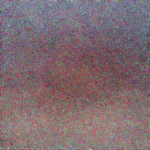

These are the settings of `uv run cgd -gif -freq 3 -size 256 -clip ViT-B/32+PE-Core-B-16 -n 90 -gl 0.99 "A volcano erupting at night"`, and the GIF is the same as that command's, byte for byte. With `save_frequency=3` it has 31 frames: every third of the 90 steps, then the result.

`modern.generate()` is the same with a backbone. With the same settings it makes the same image as the CLI, byte for byte, so this is the GIF from [Modern backbones](#modern-backbones) again:

```python
from cgd.modern import generate
from cgd.script_util import create_gif_ffmpeg

frames = [image_path for batch_idx, image_path in generate(prompts=["A red fox in the snow"], backbone="sd-turbo", seed=0, save_frequency=1)]
create_gif_ffmpeg(frames, "outputs/A_red_fox_in_the_snow_sd-turbo.gif")
```


## Full Usage - CLI

```sh
usage: cgd [-h] [--prompts PROMPTS] [--image_prompts IMAGE_PROMPTS]
           [--image_size IMAGE_SIZE] [--init_image INIT_IMAGE]
           [--init_scale INIT_SCALE] [--skip_timesteps SKIP_TIMESTEPS]
           [--prefix PREFIX] [--checkpoints_dir CHECKPOINTS_DIR]
           [--batch_size BATCH_SIZE]
           [--clip_guidance_scale CLIP_GUIDANCE_SCALE] [--tv_scale TV_SCALE]
           [--range_scale RANGE_SCALE] [--sat_scale SAT_SCALE] [--seed SEED]
           [--save_frequency SAVE_FREQUENCY]
           [--timestep_respacing TIMESTEP_RESPACING]
           [--sample_steps SAMPLE_STEPS] [--guidance_rate GUIDANCE_RATE]
           [--num_cutouts NUM_CUTOUTS] [--cutout_power CUTOUT_POWER]
           [--clip_model CLIP_MODEL] [--clip_fp16] [--uncond]
           [--device DEVICE] [--wandb_project WANDB_PROJECT]
           [--wandb_entity WANDB_ENTITY] [--height_offset HEIGHT_OFFSET]
           [--width_offset WIDTH_OFFSET] [--quiet] [--save-as-gif]
           [--save-as-video] [--clip_loss {spherical,contrastive}]
           [--aesthetic_scale AESTHETIC_SCALE] [--upscale]
           [--candidates CANDIDATES] [--x0_threshold X0_THRESHOLD]
           [--guidance_limit GUIDANCE_LIMIT]
           [--guidance_schedule {flat,sine,rising}]
           [--clip_view {blend,detached,x0}] [--pag_scale PAG_SCALE]
           [--contrast_scale CONTRAST_SCALE] [--class_rank CLASS_RANK]
           [--secondary] [--solver {dpm++2m-sde,er-sde}]
           [--backbone {sd-turbo,vega,sdxl-lightning}]
           [--iterations ITERATIONS] [--lr LR] [--noise_penalty NOISE_PENALTY]
           [--render_steps RENDER_STEPS] [--full_decoder]
           [prompt]

CLIP Guided Diffusion: generate images from text and image prompts.

positional arguments:
  prompt                the prompt/s to reward, same format as --prompts
                        (default: )

options:
  -h, --help            show this help message and exit
  --prompts, -txts PROMPTS
                        the prompt/s to reward paired with weights. e.g. 'My
                        text:0.5|Other text:-0.5' (default: )
  --image_prompts, -imgs IMAGE_PROMPTS
                        the image prompt/s to reward paired with weights. e.g.
                        'img1.png:0.5|img2.png:-0.5' (default: )
  --image_size, -size IMAGE_SIZE
                        Image size. Without --backbone one of 64, 128, 256 or
                        512, defaulting to 128. With it, any multiple of 8,
                        defaulting to what the model was trained for.
                        (default: None)
  --init_image, -init INIT_IMAGE
                        Start from this image instead of pure noise. (default:
                        )
  --init_scale, -is INIT_SCALE
                        (optional) Perceptual loss scale for init image.
                        (default: 0)
  --skip_timesteps, -skip SKIP_TIMESTEPS
                        How much of the schedule to skip with an init image.
                        Higher stays closer to it. 0 skips half. (default: 0)
  --prefix, -dir PREFIX
                        output directory (default: outputs)
  --checkpoints_dir, -ckpts CHECKPOINTS_DIR
                        Path subdirectory containing checkpoints. (default:
                        ~/.cache/clip-guided-diffusion)
  --batch_size, -bs BATCH_SIZE
                        the batch size (default: 1)
  --clip_guidance_scale, -cgs CLIP_GUIDANCE_SCALE
                        Scale for CLIP spherical distance loss. Values will
                        need tinkering for different settings. (default: 1000)
  --tv_scale, -tvs TV_SCALE
                        Controls the smoothness of the final output. (default:
                        150.0)
  --range_scale, -rs RANGE_SCALE
                        Controls how far out of RGB range values may get.
                        (default: 50.0)
  --sat_scale, -sats SAT_SCALE
                        Controls how much saturation is allowed. Used for
                        ddim. From @nshepperd. (default: 0.0)
  --seed, -seed SEED    Random number seed (default: 0)
  --save_frequency, -freq SAVE_FREQUENCY
                        Save a frame every n steps. The final image is always
                        saved. Defaults to 10, or 1 with --save-as-gif/--save-
                        as-video. (default: None)
  --timestep_respacing, -respace TIMESTEP_RESPACING
                        Use the original guided-diffusion sampler with this
                        respacing, e.g. 1000 or ddim50. Much slower. (default:
                        None)
  --sample_steps, -n SAMPLE_STEPS
                        Model calls for the fast sampler. Defaults to 30, or
                        60 with --uncond. Ignored when --timestep_respacing is
                        set. (default: None)
  --guidance_rate, -rate GUIDANCE_RATE
                        Fast sampler guidance strength, as the most CLIP may
                        move each step relative to the noise. Higher follows
                        the prompt harder but saturates. (default: 0.08)
  --num_cutouts, -cutn NUM_CUTOUTS
                        Number of randomly cut patches to distort from
                        diffusion. Defaults to 4, or 16 with
                        --timestep_respacing. (default: None)
  --cutout_power, -cutpow CUTOUT_POWER
                        Cutout size power (default: 1.0)
  --clip_model, -clip CLIP_MODEL
                        clip model name. Should be one of: ('ViT-B/16',
                        'ViT-B/32', 'RN50', 'RN101', 'RN50x4', 'RN50x16',
                        'ViT-L/14', 'PE-Core-B-16', 'ViT-L-16-SigLIP2-256',
                        'PE-Core-L-14-336', 'ViT-SO400M-16-SigLIP2-384', 'ViT-
                        gopt-16-SigLIP2-384', 'PE-Core-bigG-14-448') or a
                        checkpoint filename ending in `.pt`. Join several with
                        + to guide with all of them. Defaults to ViT-B/32, or
                        ViT-B/32+PE-Core-B-16 with --backbone. (default: None)
  --clip_fp16, -fp16    Run a PE-Core or SigLIP2 model at half precision: up
                        to 3x faster for half the CLIP VRAM. Less exact, but
                        it scored about the same. OpenAI's models always do.
                        (default: False)
  --uncond, -uncond     Use finetuned unconditional checkpoints from OpenAI
                        (256px) and Katherine Crowson (512px) (default: False)
  --device, -dev DEVICE
                        Device to use. Either cpu or cuda. (default: )
  --wandb_project, -proj WANDB_PROJECT
                        Name W&B will use when saving results. e.g.
                        `--wandb_project "my_project"` (default: None)
  --wandb_entity, -ent WANDB_ENTITY
                        (optional) Name of W&B team/entity to log to.
                        (default: None)
  --height_offset, -ht HEIGHT_OFFSET
                        Height offset for image (default: 0)
  --width_offset, -wd WIDTH_OFFSET
                        Width offset for image (default: 0)
  --quiet, -q           Suppress output. (default: False)
  --save-as-gif, -gif   Save output as high-quality GIF using ffmpeg. Deletes
                        individual frames. (default: False)
  --save-as-video, -mp4
                        Save output as high-quality MP4 video using ffmpeg.
                        Deletes individual frames. (default: False)
  --clip_loss, -loss {spherical,contrastive}
                        spherical is distance to the prompt. contrastive also
                        pushes away from the text of the ImageNet classes.
                        (default: spherical)
  --aesthetic_scale, -aes AESTHETIC_SCALE
                        Also reward what people rate highly, per point of a 1
                        to 10 rating. Default 0, or 0.05 with --backbone. The
                        README has what it trades away. (default: None)
  --upscale, -up        Also save a copy 4x larger, made with Real-ESRGAN
                        x4plus. Adds little time or VRAM. (default: False)
  --candidates, -best CANDIDATES
                        Run this many seeds, starting at --seed, and report
                        the one that models which did not guide it score best.
                        Takes this many times as long. (default: 1)

fast sampler:
  Options of the fast sampler. Ignored with --timestep_respacing or
  --backbone.

  --x0_threshold, -dt X0_THRESHOLD
                        Dynamic thresholding quantile, e.g. 0.999, instead of
                        clamping each denoised image. Keeps contrast in what
                        guidance saturates. (default: None)
  --guidance_limit, -gl GUIDANCE_LIMIT
                        Hold back whatever part of CLIP's update would push
                        more than this quantile of pixels out of range, e.g.
                        0.99. Natural colour and almost no clipped pixels,
                        though the judges prefer the saturated default.
                        (default: None)
  --guidance_schedule, -gs {flat,sine,rising}
                        Shape of --guidance_rate over the guidance window,
                        keeping its total. (default: flat)
  --clip_view, -view {blend,detached,x0}
                        What CLIP sees: the blend of the denoised and the
                        noisy image, that blend with no gradient through the
                        noisy image, or the denoised image. (default: blend)
  --pag_scale, -pag PAG_SCALE
                        Perturbed attention guidance. One more model call per
                        guided step. (default: 0)
  --contrast_scale, -contrast CONTRAST_SCALE
                        Push away from the second closest ImageNet class. One
                        more model call per guided step. (default: 0)
  --class_rank, -class CLASS_RANK
                        Condition on this closest ImageNet class, 0 being the
                        closest. (default: 0)
  --secondary, -sec     Take guidance through a small U-Net instead of the
                        diffusion model: from 5.3 to 1.9 GiB at 256 and 4.1 to
                        2.6 at 512, at no measurable loss. It scored lower at
                        128. (default: False)
  --solver, -solver {dpm++2m-sde,er-sde}
                        The sampler's solver. (default: dpm++2m-sde)

modern backbones:
  Draw with a modern one-step model and correct it with CLIP by optimising
  its noise, instead of guiding an ImageNet model. Of the options above,
  this uses the prompts, the size, offsets, batch size, seed, CLIP options,
  --aesthetic_scale, --upscale and --candidates.

  --backbone, -bb {sd-turbo,vega,sdxl-lightning}
                        The model to draw with. (default: None)
  --iterations, -iters ITERATIONS
                        Steps of noise optimisation. 0 is the plain model.
                        (default: 50)
  --lr, -lr LR          Learning rate of the noise optimisation. (default:
                        5.0)
  --noise_penalty, -np NOISE_PENALTY
                        How hard to keep the noise on the prior. (default:
                        0.01)
  --render_steps, -steps RENDER_STEPS
                        Model calls for the final image. (default: 1)
  --full_decoder, -fulldec
                        Backpropagate through the real decoder instead of a
                        tiny one. No better by score, for about twice the time
                        and 1 GiB more at 512. (default: False)
```

## Development

```sh
git clone https://github.com/afiaka87/clip-guided-diffusion.git
cd clip-guided-diffusion
uv sync
```

### Run integration tests

- Most tests run on a real GPU with the real models. Give them a free one: they fail with a genuine out of memory error if another process holds the VRAM.

```sh
uv run pytest
```
