# CLIP Guided Diffusion
From [@crowsonkb](https://github.com/crowsonkb).

<p>
<a href="https://replicate.com/afiaka87/clip-guided-diffusion" target="_blank"></a>    <a href="https://replicate.com/afiaka87/pyglide" target="_blank"></a>
</p>

The Replicate demo runs the version from October 2022, which has none of the speedups, models or options this README measures.

Disclaimer: I'm redirecting efforts to [pyglide](https://replicate.com/afiaka87/pyglide) and may be slow to address bugs here.

I also recommend looking at [@crowsonkb's](https://github.com/crowsonkb) [v-diffusion-pytorch](https://github.com/crowsonkb/v-diffusion-pytorch).

See more generations, each with its command, in the [Gallery](/images/README.md).

## Install

Requires [uv](https://docs.astral.sh/uv/getting-started/installation/).

```sh
git clone https://github.com/afiaka87/clip-guided-diffusion.git
cd clip-guided-diffusion
uv sync
```

## Run

`uv run cgd -gif -freq 3 -size 256 -clip ViT-B/32+PE-Core-B-16 -n 90 -gl 0.99 -cutn 4 "A monarch butterfly on a purple flower"`

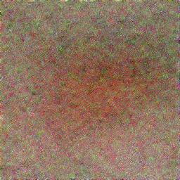

That is the classic pipeline: an ImageNet model steered by CLIP, with no extra dependencies to download. It conditions the model on the ImageNet class closest to the prompt, and prints it: `monarch butterfly`, here. `uv run cgd -gif "A monarch butterfly on a purple flower"` works too. The options were chosen by eye for a better image, and most examples here use them:

- `-size 256`, twice the default size.
- `-n 90`, three times the default steps.
- `-clip ViT-B/32+PE-Core-B-16`, an [ensemble](#ensembles), the one option that measurably improves the image.
- `-gl 0.99`, which [holds back](#--guidance-limit---gl) the part of CLIP's update that would clip, for natural colour.
- `-freq 3`, which keeps every third step, so the GIF stays small.
- `-cutn 4`, a quarter of the default [cutouts](#cutouts), for speed: it scored the same. Every image, time, VRAM figure and score in this README was made with 4, unless it says otherwise.

That took 37 s on an RTX 2070 SUPER. For the best images this repo makes, use [a modern backbone](#modern-backbones), here in 48 s:

`uv run cgd -bb sd-turbo -gif -cutn 4 "A monarch butterfly on a purple flower"`


Every GIF in this README is its command's real output, with the default seed. The one exception is the [upscaling](#upscaling) comparison, which is made from a command's two outputs.

- The path of the finished image is printed at the end. See [Speed](#speed) for how long that takes.
- Join several images with `|>`, as in `"A castle|>A red fox"`, and the animation slides from each to the next, see [Sequences](#sequences).
- `./outputs` will contain intermediate outputs, every 10 steps by default. Change this with `--save-frequency` / `-freq`.
- `current.png` will contain the current generation.
- The same `--seed` and arguments reproduce the image byte for byte on the same machine and library versions. Another version of PyTorch makes another image, and the GIFs here were made with PyTorch 2.9.1.
- Use `--gif` / `-gif` to save a high-quality GIF of every step, at 10 frames a second, and delete the frames. The frames of the batch's first image are in `outputs/<prompt>/00/`, and its GIF is `outputs/<prompt>/00.gif`.
- Use `--mp4` / `-mp4` to save a high-quality MP4 of every step the same way, as `outputs/<prompt>/00.mp4`.
- The classic pipeline's animation shows its estimate of the finished image at each step, so it runs from a blur to the image. A backbone's shows each step of CLIP reshaping an image that is finished from the first frame, and ends on the image from the full decoder.
- Animation exports require FFmpeg. Frames stream to the encoder without buffering the whole
  animation in memory. MP4 uses H.264/yuv420p, padding odd dimensions for playback compatibility.
  Exports replace the destination only after successful encoding; failures preserve source
  frames and any previous export. The final image remains available as `current.png`.
- `~/.cache/clip-guided-diffusion/` will contain downloaded checkpoints from OpenAI/Katherine Crowson.

## Usage - CLI

### Text to image generation

- The prompt, in quotes
- `--image-size` / `-size`

`uv run cgd -gif -freq 3 -size 256 -clip ViT-B/32+PE-Core-B-16 -n 90 -gl 0.99 -cutn 4 "A great grey owl perched on a branch"`

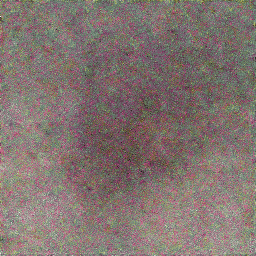

### Text to image generation (multiple prompts with weights)

- multiple prompts can be specified with the `|` character.
- you may optionally specify a weight for each prompt using a `:` character.
- e.g. `uv run cgd "Noun to visualize:1.0|style:0.1|location:0.1|something you dont want:-0.1"`
- weights must not sum to 0

`uv run cgd -gif -freq 3 -size 256 -clip ViT-B/32+PE-Core-B-16 -n 90 -gl 0.99 -cutn 4 "A steam locomotive crossing a stone bridge"`

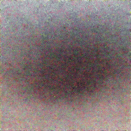

A negative weight takes the smoke away:

`uv run cgd -gif -freq 3 -size 256 -clip ViT-B/32+PE-Core-B-16 -n 90 -gl 0.99 -cutn 4 "A steam locomotive crossing a stone bridge|smoke:-0.5"`

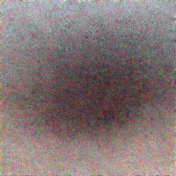

### Image prompts

`--image-prompts` / `-imgs` take paths or URLs, and the same `|` and `:` syntax. They can replace the text prompt or add to it.

`uv run cgd -gif -freq 3 -size 256 -clip ViT-B/32+PE-Core-B-16 -n 90 -gl 0.99 -cutn 4 -imgs "images/goose_on_the_run.png"`

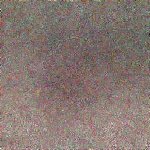

The prompt is [this goose](images/goose_on_the_run.png), a generation from 2021. The ImageNet class comes from the image prompts too: `goose`, here.

### Sequences

`uv run cgd -bb sd-turbo -size 384 -freq 5 -cutn 4 "A castle on a hill at sunset.|>A red fox in the snow.|>A sailboat on a calm lake at sunset."`

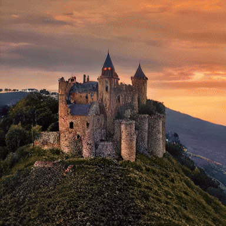

`|>` begins the next image, and the animation slides from each image to the next. Every image is the one its prompts make alone with the same options and `--seed`. They share their starting noise, which keeps them alike enough to slide between. That took 56 s on an RTX 4070.

- The first image is animated as usual, and `-freq` only thins those frames.
- `--transition-frames` / `-frames` (default: `30`, or `60` with `-bb`) is how many frames each slide takes, at 10 a second. More is smoother.
- A sequence saves a GIF without `-gif`. With `-mp4` it saves the video and no GIF.
- Each image still takes several prompts and weights, as in `"a castle|sunset:0.5|>a fox"`, and `-imgs` takes a sequence the same way. Text or image prompts that are not a sequence go with every image.
- `-best` does not apply to one.

It works best with [a modern backbone](#modern-backbones), whose image is a smooth function of its noise and of the text it is told to draw. A frame there is the model's image of the noise and the text partway between two images', which is one model call without CLIP, 0.1 s.

The ImageNet models have no such handle. There a frame is the two finished images faded into each other and redrawn by the U-Net: noised, the most halfway, and denoised without CLIP between the two ImageNet classes. Both ends are the images themselves, and halfway the model makes one picture of the double exposure. With `-uncond`, in 247 s:

`uv run cgd -uncond -freq 3 "A castle on a hill at sunset.|>A red fox in the snow.|>A sailboat on a calm lake at sunset."`

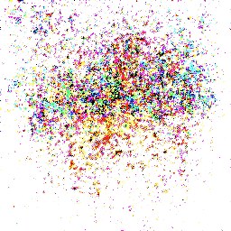

And with the default model, in 68 s:

`uv run cgd -cutn 4 "A castle on a hill at sunset.|>A red fox in the snow.|>A sailboat on a calm lake at sunset."`

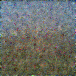

The frames go where the image changes. Each is drawn halfway between the two neighbours that differ most, so a slide moves at an even pace, a little slower near either image. On the ImageNet models three other ways to slide were tried first: drawing every frame in full with the prompts blended, which makes each frame another image because CLIP guidance is chaotic, redrawing each frame from the one before, which piles up into flat saturated colour, and sliding between the noise each image inverts to, which turns to grain with `-uncond`. `cgd/slide.py` has the numbers.

### CPU

- **Using a CPU takes much longer** than using a GPU. This took 145 s on a Ryzen 9 3900X, and 15 s without `--device cpu` on an RTX 2070 SUPER.
- The CPU runs the diffusion model at full precision, where the GPU uses half, and the same seed gives a different image on each.

`uv run cgd --device cpu -gif -freq 2 -clip ViT-B/32+PE-Core-B-16 -n 60 -gl 0.99 -cutn 4 "A wooden cabin in a snowy forest"`

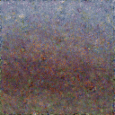

### CUDA GPU

There's no need to specify a device: without `--device`, it uses CUDA whenever PyTorch can.

On Windows, NVIDIA's driver lends a program system memory when the GPU's runs out, which is many times slower. `cgd` takes only what the GPU has free there, so a run that does not fit stops with advice on what to change, as it does elsewhere.

`uv run cgd -gif -freq 3 -size 256 -clip ViT-B/32+PE-Core-B-16 -n 90 -gl 0.99 -cutn 4 "A wooden cabin in a snowy forest"`

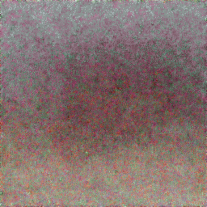

### Steps

`--steps` / `-n` (default: `30`)

- The number of steps down the schedule, each a model call. Fewer is faster.
- `30` matches the original sampler on prompts held out from tuning. `20` is a third faster, but doubles the share of clipped pixels. Below `15` quality falls off quickly.
- [`--unconditional`](#unconditional-checkpoints) defaults to `60`. Without a class label it needs the extra steps, see [Speed](#speed), and it takes the early ones twice, see [Recurrence](#recurrence).

`--guidance-rate` / `-rate` (default: `0.08`)

- The most CLIP may move the image each step, relative to the noise. Higher follows the prompt harder, but saturates and clips the image.

### Existing image

#### `--init-image` / `-init`

- Start from an image instead of pure noise.

#### `--skip-timesteps` / `-skip`

How much of the 1000 step schedule to skip. Higher stays closer to the image. Defaults to half of it, `500`.

#### `--init-scale` / `-is` (optional)

Adds a VGG perceptual loss ([LPIPS](https://github.com/richzhang/PerceptualSimilarity)) between the image and the init image, which keeps the init's composition. 1000 seems to work well. In this example `0` sank the cap into tall grass and lost the stem, `3000` kept the fence behind the mushroom but barely turned it red, and `1000` sits between them.

```sh
uv run cgd -gif -freq 3 -size 256 -clip ViT-B/32+PE-Core-B-16 -n 90 -gl 0.99 -cutn 4 \
  --init-image images/32K_HUHD_Mushroom.png \
  --init-scale 1000 \
  --skip-timesteps 300 \
  "A red mushroom in the grass"
```

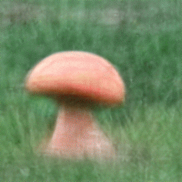

The init image is [this mushroom](images/32K_HUHD_Mushroom.png), a generation from 2021. Skipping 300 of the 1000 steps leaves 66 of the 90 model calls, so the GIF has 23 frames.

### Image size

- options: `64, 128, 256, 512 pixels (square)`, `256` or `512` with [`--unconditional`](#unconditional-checkpoints), or any multiple of 8 with [`--backbone`](#modern-backbones)
- Every size runs in 8 GB of VRAM with the default CLIP model. See [Speed](#speed) for the time and memory each one takes, and [CLIP models](#clip-models) for the models that need more.
- Above 256x256 pixels per batch, the U-Net recomputes its activations during guidance instead of storing them. That takes about 1.5x the time per guided step and under half the memory, and it is automatic.

```sh
uv run cgd -gif -cutn 4 --init-image images/32K_HUHD_Mushroom.png \
    --skip-timesteps 500 \
    --image-size 64 \
    "8K HUHD Mushroom"
```

</img>
_resized to 200 pixels for visibility_

```sh
uv run cgd -gif -freq 2 -size 512 -clip ViT-B/32+PE-Core-B-16 -n 60 -gl 0.99 -cutn 4 "A sailboat on a calm lake at sunset"
```

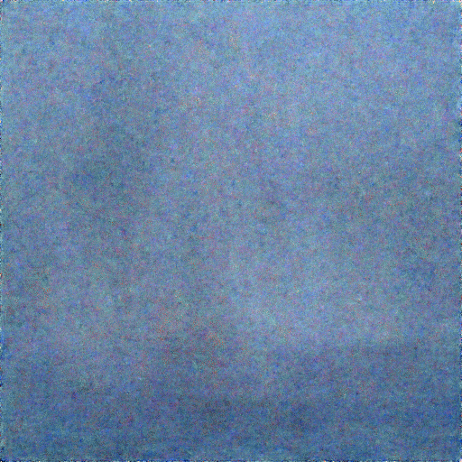

`-n 60` instead of 90, because each step costs more at 512. That took 53 s.

**Non-square generations**

Generate portrait or landscape images by specifying a number to offset the width and/or height, with `--width-offset` / `-wd` and `--height-offset` / `-ht`.

- height and width must be multiples of an eighth of the image size: 8 at 64x64, 16 at 128x128, 32 at 256x256, 64 at 512x512. With [`--backbone`](#modern-backbones), any multiple of 8.
- None of 12 runs from 80x64 to 640x512 produced NaN or Inf, and by eye the images were as clean as square ones.
- a positive offset will require more memory.
- a _negative_ offset uses less memory and is faster.

```sh
uv run cgd -gif -freq 3 -size 256 -clip ViT-B/32+PE-Core-B-16 -n 90 -gl 0.99 -cutn 4 \
    --width-offset 128 \
    "A castle on a hill at sunset"
```

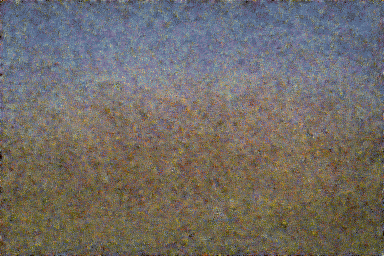

### Unconditional checkpoints

`--unconditional` / `-uncond`

`uv run cgd -uncond -gif -freq 3 "A red fox in the snow"`

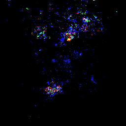

That took 31 s on an RTX 4070, from start to GIF. `-uncond` draws with a model that takes no class label: OpenAI's at 256x256, the default size, and at 512x512 Katherine Crowson's fine-tune of OpenAI's class-conditional model. Without a class only guidance brings the subject, so it is less reliable than the default. `-uncond` alone runs the settings that made its best images for the time they take, and each of these options overrides its own:

| Option | With `-uncond` | Why |
|---|---|---|
| `-clip` | `ViT-B/32+PE-Core-B-16` | The [ensemble](#ensembles) |
| `-cutn` | `4` | Scores as `16` does, in three quarters of the time, see [Thumbnail guidance](#thumbnail-guidance) |
| `-n` | `60` | Guidance starts at the very beginning of the schedule, where the composition is set, and twice the steps keep that from overshooting |
| `-recur` | `2` | Each guided step in the first 70% of the schedule runs twice, 91 model calls in all, see [Recurrence](#recurrence) |
| `-thumb` | `clip` | A second model sets the composition, see [Thumbnail guidance](#thumbnail-guidance) |

So `uv run cgd -uncond -thumb karlo -cutn 16 "A red fox in the snow"` changes the thumbnail model and the cutouts, and keeps the rest. Add `-gif` or `-mp4` to any of them as usual.

### Thumbnail guidance

`--thumbnail` / `-thumb` (default: `clip` with `-uncond`; one of `clip`, `glide`, `laionide`, `karlo`, `none`)

`uv run cgd -uncond -thumb karlo -cutn 16 -gif -freq 3 "A red fox in the snow"`

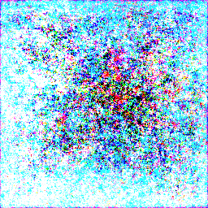

CLIP is a poor judge of a nearly pure noise image, and that is when the composition forms. A model trained on noisy 64x64 images is a good one. Each step the noisy image is averaged down to a 64x64 thumbnail, the model says what the text prompts change about the thumbnail's noise, and that is added to the U-Net's prediction, enlarged. The U-Net still draws every detail, and CLIP guides as before. It needs a text prompt and a square image: without either `-uncond` runs without it and says so.

| `-thumb` | What it is | PickScore | Rating | Time | Peak VRAM | At `-cutn 4` | Download | License |
|---|---|---|---|---|---|---|---|---|
| `none` | CLIP alone | 20.71 | 5.14 | 30.2 s | 5.9 GiB | 20.68, 5.32, 20.5 s | | |
| `clip` (default) | OpenAI's CLIP of noisy images, released with GLIDE | 21.26 | 5.57 | 30.3 s | 6.5 GiB | **21.43, 5.55, 22.4 s** | 0.6 GB | MIT |
| `clip` with [`-pag`](#perturbed-attention-guidance) | | 21.72 | 5.72 | 39.0 s | 6.6 GiB | 21.44, 5.64, 31.5 s | | |
| `glide` | [GLIDE](https://github.com/openai/glide-text2im)'s 64x64 text-to-image model | 21.50 | 5.55 | 32.1 s | 6.7 GiB | 21.05, 5.48, 24.4 s | 1.5 GB | MIT |
| `laionide` | [LAIONIDE v3](https://github.com/afiaka87/laionide), GLIDE fine-tuned on LAION | 21.47 | 5.59 | 32.6 s | 6.7 GiB | | 1.5 GB | Its repository is MIT. The checkpoint states none |
| `karlo` | The decoder and prior of [Karlo](https://huggingface.co/kakaobrain/karlo-v1-alpha), an open unCLIP | 22.65 | 5.81 | 34.1 s | 7.8 GiB | | 8.2 GB | CreativeML Open RAIL-M |

12 prompts held out from tuning over 3 seeds at 256, with `-cutn 16` but for the column that says otherwise, on an RTX 4070. The `-uncond` default is in bold. [PickScore](https://github.com/yuvalkirstain/PickScore) is a model of which image people pick for a prompt, the rating is the predictor from [Modern backbones](#modern-backbones), and neither guided the images. Time is per image with the models loaded. For scale, `-bb sd-turbo` scores 24.07 and 7.07. These were measured with the experiments the options were built from, in [the report](<reports/Unconditional ADM CLIP guidance quality.md>), and the options make those experiments' images byte for byte. Nothing was measured at 512, where the thumbnail is an eighth of the image.

- **`clip` is the default** because it costs little time: +0.75 ± 0.40 PickScore over `none` at 4 cutouts, in 22.4 s against 20.5 s, and at 16 a judge who saw only unlabelled pairs preferred it in 18 of 24. 16 cutouts add nothing to it, +0.17 ± 0.34, for 8 s more, so `-uncond` runs 4. It is a classifier, so with it nothing in the pipeline was trained to draw from text.
- **`karlo` makes the best images**, preferred blind in 23 of 24 pairs, for an 8.2 GB download and 2 GiB more VRAM. But Karlo's own pipeline scores the same in 3 seconds, so it is here to play with, not as the way to use Karlo.
- **`glide` and `laionide`** tie each other at 16 cutouts, a little ahead of `clip` on PickScore and level on the rating, for 2 s more. They were trained to draw from text. At 4, GLIDE fell behind `clip`, -0.45 ± 0.52 PickScore against itself at 16, so run these two and `karlo` with `-cutn 16`, as they were measured.
- **`none`** is CLIP alone, what `-uncond` was before.

The same prompt and seed with each of the others, and how long the command took on an RTX 4070, from start to GIF: 50 s with `karlo` above, 31 s with `clip` in [Unconditional checkpoints](#unconditional-checkpoints), and

`uv run cgd -uncond -thumb glide -cutn 16 -gif -freq 3 "A red fox in the snow"`, 45 s

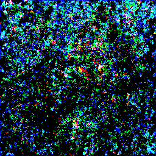

`uv run cgd -uncond -thumb laionide -cutn 16 -gif -freq 3 "A red fox in the snow"`, 43 s

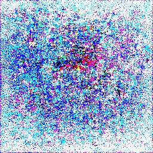

`uv run cgd -uncond -thumb none -gif -freq 3 "A red fox in the snow"`, 30 s

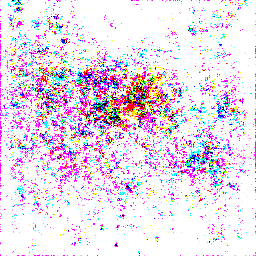

### Perturbed attention guidance

`--perturbed-attention` / `-pag`

`uv run cgd -uncond -pag -cutn 16 -gif -freq 3 "A red fox in the snow"`

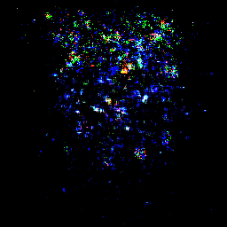

That took 49 s on an RTX 4070, from start to GIF. It also moves each prediction away from one the U-Net makes with the self-attention of four layers switched off, the layers and scale of the [PAG paper](https://arxiv.org/abs/2403.17377) for this checkpoint. That is one more model call a step, and only for `-uncond` at 256. Pictures come out more finished and follow the prompt a little less. With `-thumb clip` at 16 cutouts it beat `-thumb none` in 20 of 24 blind pairs. Over `-thumb clip` alone it adds less: +0.46 ± 0.53 PickScore for 9 s, and on 66 more prompts +0.18 ± 0.15 with the held-out CLIP models' score down 0.012 ± 0.006. At 4 cutouts, the default, it added nothing to PickScore, 21.44 against 21.43 at 31.5 s against 22.4 s. At 16 it scores 0.28 ± 0.29 more than at 4, the highest PickScore and rating of any option without a text-to-image model, so give it `-cutn 16`. Without thumbnail guidance it loses the subject, -0.029 ± 0.018 on the CLIP models. Off by default.

## Modern backbones

`--backbone` / `-bb`

`uv run cgd -bb sd-turbo -gif -cutn 4 "A red fox in the snow"`


The ImageNet models only learned ImageNet, and CLIP cannot supply what a model never learned. With `-bb` a modern one-step model draws the image, and CLIP corrects it by optimising the model's starting noise for 50 steps ([ReNO](https://arxiv.org/abs/2406.04312)). There is no solver to tune, the noise stays on the model's prior, and the same `--seed` still reproduces the image byte for byte.

| `-bb` | Size | Plain, `-iters 0` | With CLIP | Download | License |
|---|---|---|---|---|---|
| `sd-turbo` (start here) | 512 (default) | 6.4 s, 2.5 GiB | 27.2 s, 3.2 GiB | 2.5 GB | [Stability Community](https://stability.ai/community-license-agreement). Commercial use needs registration and ends above USD 1M revenue |
| `vega` | 768 | 9.5 s, 2.9 GiB | 36.0 s, 3.6 GiB | 3.6 GB | Apache-2.0 |
| | 1024 (default) | 9.9 s, 3.9 GiB | 49.8 s, 4.7 GiB | | |
| `sdxl-lightning` | 768 | 10.4 s, 6.3 GiB | 57.6 s, 7.0 GiB | 12 GB | [OpenRAIL++](https://huggingface.co/stabilityai/stable-diffusion-xl-base-1.0/blob/main/LICENSE.md) |
| | 1024 (default) | 10.2 s, 7.3 GiB | Out of memory on 8 GB | | |

Wall clock for one image with `cgd`, including startup and loading with the weights already on disk, and peak VRAM, on an RTX 2070 SUPER with 8 GB and nothing else on it, at `-cutn 4`. With CLIP means the other defaults, `ViT-B/32+PE-Core-B-16` and `-aes 0.05`. `sdxl-lightning` at its default 1024 needs `-size 768 -cutn 4` on 8 GB, or `-iters 0`, which skips CLIP. Even a single `-clip ViT-B/32` runs out of memory there. It should fit 12 GB with CLIP, but nothing has been run on an RTX 4070. Weights go to the Hugging Face cache.

How the images score, on 12 prompts held out from tuning, 3 seeds on SD-Turbo and 4 on ADM, at `-cutn 4`. The first three columns are CLIP similarity to the prompt on models that did not guide the image, and the last is a predicted human rating from 1 to 10 made by a [ViT-B/16 predictor](https://github.com/crowsonkb/simulacra-aesthetic-models) that also did not guide it.

| | `ViT-B/16` | `ViT-H-14-quickgelu` | `ViT-L-16-SigLIP2-256` | Rating |
|---|---|---|---|---|
| Default ADM, 128 | 0.293 | 0.289 | 0.109 | 4.79 |
| ADM, 128, with an [ensemble](#ensembles) | 0.308 | 0.313 | 0.127 | 4.85 |
| `-bb sd-turbo -iters 0` | 0.342 | 0.373 | 0.184 | 6.48 |
| `-bb sd-turbo -aes 0` | 0.357 | 0.385 | 0.193 | 6.35 |
| `-bb sd-turbo` | 0.350 | 0.384 | 0.194 | 6.90 |

The swap is by far the biggest gain measured here, over four times the best change that stays on ADM. Size explains little of it: ADM at 512 gains 0.025 ± 0.029 over ADM at 128 on one seed, against 0.081 for the swap. These models resize to about 224 pixels, so they cannot see fine detail, and no person has rated these images.

At 768, on one seed and with `-aes 0.1` on the whole frame, CLIP added 0.010 to `vega`, which still scored 0.005 below `sd-turbo` at 512 and looks softer and less saturated. `sdxl-lightning` was the sharpest by eye, and CLIP added nothing measurable to it, so `-iters 0` is its best setting unless you want the [aesthetic term](#aesthetic). At 1024 only time and memory were measured.

- `--iterations` / `-iters` (default `50`): `100` takes twice as long and adds 0.002. `200` adds 0.006 on one seed, and starts to look adversarial. `25` loses 0.010.
- The prompt conditions the model as well as CLIP, except for negative weights, which only CLIP sees.

## Speed

Wall clock for `uv run cgd -cutn 4`, including startup and model loading, on an RTX 2070 SUPER with 8 GB:

| Size | Sampler | Model calls | Time | Peak VRAM |
|---|---|---|---|---|
| 64 | default | 30 | 4.9 s | 1.6 GiB |
| 128 | default | 30 | 6.5 s | 2.4 GiB |
| 256 | default | 30 | 11.4 s | 5.3 GiB |
| 512 | default | 30 | 22.4 s | 4.1 GiB |
| 256 | `-uncond -clip ViT-B/32 -thumb none -recur 1` | 60 | 20.0 s | 5.3 GiB |
| 512 | `-uncond -clip ViT-B/32 -thumb none -recur 1` | 60 | 48.1 s | 4.1 GiB |
| 128 | the original, since removed | 1000 | 2 min 16 s | |
| 256 | the original with `-uncond`, since removed | 1000 | 6 min | |

`-uncond` has since taken its early steps twice by default, see [Recurrence](#recurrence), and guides with the ensemble and a thumbnail model, see [Unconditional checkpoints](#unconditional-checkpoints). With those defaults it takes 22.4 s an image on an RTX 4070 once the models are loaded, see [Thumbnail guidance](#thumbnail-guidance). The same on an RTX 4070 with 12 GB under Windows, where starting up takes longer:

| Size | Sampler | Model calls | Time | Peak VRAM |
|---|---|---|---|---|
| 128 | default | 30 | 6.9 s | 2.4 GiB |
| 256 | default | 30 | 9.8 s | 5.3 GiB |
| 256 | `-uncond -clip ViT-B/32 -thumb none -recur 1` | 60 | 15.4 s | 5.3 GiB |
| 256 | `-uncond -clip ViT-B/32 -thumb none` | 91 | 21.3 s | 5.3 GiB |
| 512 | `-uncond -clip ViT-B/32 -thumb none -recur 1` | 60 | 34.1 s | 4.1 GiB |
| 512 | `-uncond -clip ViT-B/32 -thumb none` | 91 | 50.2 s | 4.1 GiB |

Quality was measured on prompts held out from tuning, as the ViT-B/16 CLIP similarity to the prompt. Guidance uses ViT-B/32, so this model is not the one being optimised.

- **128px, 12 prompts:** a tie with the original 1000 step sampler, 0.292 against 0.292 (difference 95% CI -0.018 to +0.016), with fewer clipped pixels, 6% against 7%. The look is different though, and any single image is not the same image.
- **`-uncond`, 256px, 6 prompts:** behind the original sampler, 0.316 against 0.331 (difference 95% CI -0.040 to +0.014), and the original scored higher on 5 of the 6, at 18x the time. With no class to bring the subject, CLIP has to set the composition too. That was at `-recur 1`, before [recurrence](#recurrence) became its default.

The original pipeline takes 1000 ancestral steps, because CLIP has to build the whole image while the U-Net follows a random class that changes every step. The sampler in `cgd/sampler.py` gets there in 30 model calls:

- The U-Net is conditioned on the ImageNet class closest to your prompt, so it brings the subject and CLIP only steers.
- A second-order stochastic solver, DPM-Solver++(2M) SDE, covers the schedule in uniform logSNR steps.
- Guidance is capped relative to the noise, so it stays stable with steps 33x larger than the original's.
- Guidance only runs from 10% to 80% of the schedule, where it helps. The other steps also skip backpropagating through the U-Net, the most expensive part of guidance.
- CLIP sees random cutouts, 16 by default, as many as the original. At 128px they span 70-100% of the frame, where the original's were all the same full frame. At 512px they span 44-100%, because a cutout is never smaller than CLIP's 224px input. See [Cutouts](#cutouts).
- `-uncond` has no class to bring the subject, so guidance also sets the composition. It starts right at the beginning of the schedule, and the sampler takes twice the steps so that does not overshoot. It takes each guided step in the first 70% of the schedule twice, see [Recurrence](#recurrence), and a second model reads the noisy image as a thumbnail, see [Thumbnail guidance](#thumbnail-guidance).

Model loading is faster too: checkpoints are memory mapped instead of copied, nothing is randomly initialised just to be overwritten, and the ImageNet class features are cached on disk.

## CLIP models

`--clip-model` / `-clip` (default: `ViT-B/32`, or `ViT-B/32+PE-Core-B-16` with [`--unconditional`](#unconditional-checkpoints) or [`--backbone`](#modern-backbones))

`uv run cgd -gif -freq 3 -clip PE-Core-L-14-336 -size 256 -n 90 -gl 0.99 -cutn 4 "A red fox in the snow"`

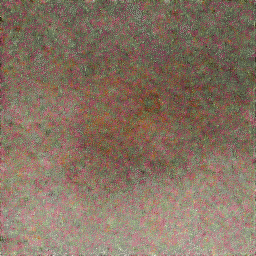

Join models with `+` to guide with all of them, see [Ensembles](#ensembles).

OpenAI's `RN50`, `RN101`, `RN50x4`, `RN50x16`, `ViT-B/16`, `ViT-B/32` and `ViT-L/14` are still there. These are the newer ones, from [open_clip](https://github.com/mlfoundations/open_clip): Meta's [PE-Core](https://arxiv.org/abs/2504.13181) and Google's [SigLIP 2](https://arxiv.org/abs/2502.14786).

| Model | ImageNet zero-shot | Input | Download | Load |
|---|---|---|---|---|
| `ViT-B/32` (default) | 63.3% | 224 | 0.3 GiB | 0.8 s |
| `PE-Core-B-16` | 78.4% | 224 | 1.7 GiB | 2.6 s |
| `ViT-L-16-SigLIP2-256` | 82.5% | 256 | 3.3 GiB | 3.9 s |
| `PE-Core-L-14-336` | 83.5% | 336 | 2.5 GiB | 3.9 s |
| `ViT-SO400M-16-SigLIP2-384` | 84.1% | 384 | 4.2 GiB | 4.7 s |
| `ViT-gopt-16-SigLIP2-384` | 85.0% | 384 | 7.0 GiB | 8.5 s |
| `PE-Core-bigG-14-448` | 85.4% | 448 | 9.0 GiB | 13.4 s |

Accuracy is as published by open_clip and Meta. Weights download to `~/.cache/clip-guided-diffusion/clip/` the first time a model is used. Loading takes about the download size in system RAM.

The first run of each model also encodes the ImageNet class names, once, on the CPU: 2 minutes for `ViT-gopt-16-SigLIP2-384`, 2.5 for `PE-Core-bigG-14-448`, on a Ryzen 9 3900X.

### Which one to use

Use the pair `ViT-B/32+PE-Core-B-16`, see [Ensembles](#ensembles). Of the single models, `PE-Core-B-16` looked best: it takes the same VRAM as the default and about 1.3 s more per image, it was the only model to beat `ViT-B/32` with all three judges at 128 on seed 0, and at 256 it does as well as the bigger models. Over 4 more seeds at 128 that lead shrank to a tie, +0.001 ± 0.015, so on its own it is not worth the download.

Higher ImageNet accuracy did not make a better guide. `ViT-gopt-16-SigLIP2-384` and `PE-Core-bigG-14-448` tie or trail the default by score, at 5x to 15x the time at 128. By eye they draw the most photographic images, which can work against the prompt: `ViT-gopt-16-SigLIP2-384` at fp32 turned "a pencil sketch of an old man with a beard" into a photo of a bird. `ViT-SO400M-16-SigLIP2-384` at fp32 wrote nonsense text across "a plate of sushi on a black slate".

`ViT-B/32` stays the default because it is the fastest and its gradient is by far the smoothest.

Each cell is the change in CLIP similarity to the prompt against `ViT-B/32`, on 12 prompts held out from tuning with seed 0 and `-cutn 4`, then how many of the 12 improved. Three models judged the images, and a model never grades its own guidance, hence the empty cells. `ViT-B/16` is close kin to `ViT-B/32`, so it favours it. `-rate` was tuned on `ViT-B/32` and not retuned per model. The 95% interval on a difference is about ±0.03, so most of these are ties.

128:

| Model | Precision | `ViT-B/16` | `ViT-H-14-quickgelu` | `ViT-L-16-SigLIP2-256` |
|---|---|---|---|---|
| `PE-Core-B-16` | fp32 | +0.014 (8) | +0.016 (10) | +0.025 (8) |
| `ViT-L-16-SigLIP2-256` | fp32 | -0.019 (5) | +0.010 (5) | |
| | `-fp16` | -0.008 (5) | +0.007 (6) | |
| `PE-Core-L-14-336` | fp32 | -0.017 (4) | +0.001 (7) | +0.001 (5) |
| | `-fp16` | -0.011 (5) | +0.017 (9) | +0.011 (8) |
| `ViT-SO400M-16-SigLIP2-384` | fp32 | -0.010 (3) | +0.005 (6) | +0.017 (8) |
| | `-fp16` | -0.019 (4) | -0.009 (4) | -0.008 (5) |
| `ViT-gopt-16-SigLIP2-384` | fp32 | -0.025 (3) | -0.012 (6) | -0.017 (6) |
| | `-fp16` | -0.031 (2) | +0.004 (7) | -0.003 (7) |
| `PE-Core-bigG-14-448` | `-fp16` | -0.022 (6) | -0.001 (8) | -0.001 (7) |

256:

| Model | Precision | `ViT-B/16` | `ViT-H-14-quickgelu` | `ViT-L-16-SigLIP2-256` |
|---|---|---|---|---|
| `PE-Core-B-16` | fp32 | -0.002 (4) | +0.018 (7) | +0.031 (12) |
| `PE-Core-L-14-336` | fp32 | -0.004 (5) | +0.020 (9) | +0.032 (10) |
| `ViT-SO400M-16-SigLIP2-384` | fp32 | -0.021 (3) | +0.018 (8) | +0.035 (11) |
| `ViT-gopt-16-SigLIP2-384` | `-fp16 -cutn 2` | -0.041 (3) | -0.014 (5) | -0.003 (5) |

`-fp16` moved scores in both directions, by less than the noise, which is why it counts as no measurable difference.

### Time and VRAM

Time to sample one image and peak VRAM at `-cutn 4`, the median of 3 prompts on an RTX 2070 SUPER with 8 GB and nothing else on it. Each cutout runs CLIP once more, so the default 16 take longer and more VRAM, most of all with the bigger models. Add the load time above, once per run. `~` marks a size that ran out of memory on this card: the number is what it should need, projected from the models that ran at that size, and has not been measured.

| Model | Precision | 128 | 256 | 512 |
|---|---|---|---|---|
| `ViT-B/32` | | 2.7 s, 2.3 GiB | 7.5 s, 5.3 GiB | 18.7 s, 4.1 GiB |
| `PE-Core-B-16` | fp32 | 4.0 s, 2.4 GiB | 8.8 s, 5.3 GiB | 20.0 s, 4.1 GiB |
| | `-fp16` | 3.3 s, 2.2 GiB | 8.2 s, 5.2 GiB | 19.4 s, 4.0 GiB |
| `ViT-L-16-SigLIP2-256` | fp32 | 7.5 s, 3.3 GiB | 12.5 s, 6.3 GiB | 23.8 s, 4.9 GiB |
| | `-fp16` | 4.2 s, 2.6 GiB | 9.2 s, 5.6 GiB | 20.5 s, 4.4 GiB |
| `PE-Core-L-14-336` | fp32 | 16.0 s, 3.7 GiB | 20.7 s, 6.6 GiB | 32.3 s, 4.9 GiB |
| | `-fp16` | 7.8 s, 2.8 GiB | 12.7 s, 5.8 GiB | 24.0 s, 4.4 GiB |
| `ViT-SO400M-16-SigLIP2-384` | fp32 | 19.3 s, 4.2 GiB | 24.1 s, 7.1 GiB | 35.4 s, 5.4 GiB |
| | `-fp16` | 7.8 s, 3.1 GiB | 12.7 s, 6.0 GiB | 24.0 s, 4.6 GiB |
| `ViT-gopt-16-SigLIP2-384` | fp32 | 42.0 s, 7.2 GiB | ~10 GiB | ~8.5 GiB |
| | `-fp16` | 13.7 s, 4.6 GiB | ~7.5 GiB | 30.0 s, 5.9 GiB |
| `PE-Core-bigG-14-448` | fp32 | ~11.5 GiB | ~14.5 GiB | ~13 GiB |
| | `-fp16` | 35.3 s, 6.6 GiB | ~9.5 GiB | ~8 GiB |

256 needs more than 512 because 512 is the size where the U-Net starts recomputing its activations, see [Image size](#image-size). PyTorch holds on to about 0.1 GiB beyond the peak at 128 and 256, and up to 0.9 GiB at 512, so leave that free too.

| VRAM | What fits at `-cutn 4` |
|---|---|
| 8 GB | Everything through `ViT-SO400M-16-SigLIP2-384`, at every size, though that one at 256 fp32 needs a nearly empty card. `ViT-gopt-16-SigLIP2-384` at 128, at 512 with `-fp16`, or at 256 with `-fp16 -cutn 2` (31.5 s, 7.3 GiB). `PE-Core-bigG-14-448` at 128 with `-fp16`. |
| 12 GB (estimated) | `ViT-gopt-16-SigLIP2-384` at every size. `PE-Core-bigG-14-448` at every size with `-fp16`. |
| 16 GB (estimated) | Everything, at every size. |

### `--clip-fp16` / `-fp16`

Runs the vision tower of a PE-Core or SigLIP2 model at half precision: up to 3x faster and half the CLIP VRAM. fp32 stays the default because it is the exact computation, but use `-fp16` whenever time or VRAM matters: it made no measurable difference to quality, see [Which one to use](#which-one-to-use). It saves little on `PE-Core-B-16`, and that one combination has no quality measurement.

The gradient does change. Its cosine similarity to the fp32 gradient varied by model and image, over 3 images: 0.11 to 0.42 for `ViT-gopt-16-SigLIP2-384`, 0.19 to 0.996 for `PE-Core-L-14-336`, 0.83 to 0.93 for `PE-Core-B-16`, 0.95 to 0.9995 for `ViT-L-16-SigLIP2-256` and 0.99 for `ViT-SO400M-16-SigLIP2-384`. That says less than it seems to, because these gradients are chaotic: noise of 1 part in 2048 on the input image, without changing the precision at all, moves the fp32 gradient to a cosine of 0.52 to 0.79 for `ViT-gopt-16-SigLIP2-384` and 0.39 to 0.97 for `PE-Core-L-14-336`. Guidance averages over cutouts and steps, so it follows what stays consistent. `ViT-B/32`, by comparison, stays at 0.999 under the same noise. OpenAI's models always run at half precision, and at 0.9997 to 0.9999 lose nothing by it.

## What improves the image

Everything here was measured against the default on 12 prompts held out from tuning, as the change in CLIP similarity to the prompt pooled over the three models above, with its 95% interval across prompts, and how many of the 12 improved. ADM at 128 over 4 seeds unless noted, and SD-Turbo at 512 over 3, all at `-cutn 4`. A difference smaller than the interval is a tie. Options that lost were removed, see [Tried and removed](#tried-and-removed). `-gl` and `-aes` stay off by default but stay available, because a score is not an image: these models cannot see fine detail, and they reward caption match, not looks. Full evidence is in [the report](<reports/CLIP guided diffusion quality improvements.md>).

### Ensembles

`uv run cgd -gif -freq 3 -size 256 -clip ViT-B/32+PE-Core-B-16 -n 90 -gl 0.99 -cutn 4 "A red fox in the snow"`

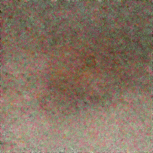

The one change that clearly helps ADM, and the default with `-bb`. Each model backpropagates on its own, so only one model's activations are in memory at a time.

| Size | Change | Default | Ensemble |
|---|---|---|---|
| 128 | +0.019 ± 0.015 (10), 4 seeds | 2.9 s, 2.3 GiB | 5.9 s, 2.7 GiB |
| 256 | +0.015 ± 0.014 (7), 2 seeds | 7.8 s, 5.3 GiB | 10.7 s, 5.6 GiB |
| 512 | +0.012 ± 0.015 (9), 1 seed | 18.8 s, 4.1 GiB | 21.6 s, 4.4 GiB |

That includes loading both models for every image, which a single `cgd` run only does once. `PE-Core-B-16` on its own only ties (+0.001 ± 0.015), so it takes the pair. It is not the ADM default because that would change every existing seed's image, and it needs a 1.7 GiB download.

### Recurrence

`--recurrence` / `-recur` (default: `1`, or `2` with [`--unconditional`](#unconditional-checkpoints))

`uv run cgd -uncond -recur 3 "A red fox in the snow"`

Takes each guided step in the first 70% of the schedule this many times. After a step the image goes back up to the step's noise level with fresh noise, and the step is taken again. CLIP gets another say at the noise levels where the composition forms, and the U-Net another try at a picture of what CLIP asked for, without the schedule getting longer.

It is the default with `-uncond`, where only guidance brings the subject. There, with `-thumb none -cutn 16` over 3 seeds, `2` gains +0.015 ± 0.013 (9) over `1`, at 30 s an image against 18 s on an RTX 4070. Spending the same model calls on more steps, `-n 90`, gained as much CLIP similarity on an RTX 2070 SUPER but none of the aesthetic rating recurrence added, +0.51 ± 0.34 (11). `3` gained +0.023 ± 0.012 (10) there, at 2.3 times the time of `1`.

The class-conditional models stay at `1`. At 128 with the defaults over 3 seeds, `2` is +0.012 ± 0.015 (9), a tie, for half as long again, and making it the default would change every existing seed's image.

### Keep the best of several seeds

`--candidates` / `-best`

`uv run cgd -best 4 -gif -cutn 4 "A red fox in the snow"`

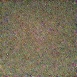

Runs that many seeds from `--seed`, and reports the one that `ViT-B/16` and `ViT-L-16-SigLIP2-256` prefer. Here they picked seed 0, the image `--seed 0` gives on its own. Each candidate's frames go in `outputs/seed_<n>/`, and only the pick's become a GIF or video. Takes that many times as long, and the judges run on the CPU. Picked that way and scored by `ViT-H-14-quickgelu`, which did not pick, against the average candidate: ADM best of 4 gains +0.015 ± 0.007 (11), or +0.025 ± 0.011 (12) with the ensemble. SD-Turbo best of 3 gains +0.005 ± 0.005 (8), so it matters much less there.

### Upscaling

`--upscale` / `-up`

`uv run cgd -gif -freq 3 -up -clip ViT-B/32+PE-Core-B-16 -n 90 -gl 0.99 -cutn 4 "A monarch butterfly on a purple flower"`

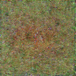


Also saves a copy of the finished image 4x larger, made with [Real-ESRGAN x4plus](https://github.com/xinntao/Real-ESRGAN), a 64 MB download. It goes in the frames' folder, `outputs/A_monarch_butterfly_on_a_purple_flower/00/0089_x4.png` here, and the animation stays at the size that was sampled. The second GIF wipes between that copy and the same image enlarged 4x with plain bicubic resampling. It invents detail and cannot fix what the image got wrong. ADM at 128 plus `-up` ties ADM at 512 on score, -0.014 ± 0.028 (6) on one seed, for 3 s instead of 19 s and 2.3 instead of 4.1 GiB, so it is the cheap route to 512 on ADM and not a better one: direct 512 clips fewer pixels, 4.1% against 10.4%, and gets a higher predicted rating, 5.32 against 4.83. Going from 512 to 2048 takes under a second and about 2 GiB.

### Aesthetic

`--aesthetic-scale` / `-aes` (default `0.05` with `-bb`, otherwise `0`)

`uv run cgd -bb sd-turbo -aes 0.1 -gif -cutn 4 "A red fox in the snow"`


Also rewards what people rate highly, with Katherine Crowson's [aesthetic predictor](https://github.com/crowsonkb/simulacra-aesthetic-models) for `ViT-B/32`. The scale is per point of a rating from 1 to 10. It rates random cutouts instead of the whole frame, because cutouts raised the held-out rating more per point of score lost, on both models.

| | `-aes` | Rating | Change in score | Saturation | Clipped pixels |
|---|---|---|---|---|---|
| `-bb sd-turbo`, 512 | 0 | 6.35 | | 0.36 | 2.3% |
| | 0.05 (default) | 6.90 | -0.002 ± 0.004 (3) | 0.42 | 2.1% |
| | 0.1 | 7.12 | -0.011 ± 0.008 (1) | 0.45 | 1.9% |
| | 0.2 | 7.24 | -0.012 ± 0.006 (2) | 0.50 | 3.4% |
| ADM, 128 | 0 (default) | 4.79 | | 0.46 | 2.8% |
| | 0.05 | 5.27 | -0.013 ± 0.008 (1) | 0.60 | 3.8% |
| | 0.1 | 5.52 | -0.022 ± 0.009 (1) | 0.62 | 6.6% |
| | 0.2 | 5.67 | -0.047 ± 0.012 (0) | 0.66 | 6.7% |

The rating is a `ViT-B/16` predictor that did not guide the image. The rating and the score pull apart, so choosing a scale means choosing between them. On SD-Turbo `0.05` costs nothing measurable, which makes it the default. By eye, on six prompts, `0.1` and `0.2` often have better light and composition than `0.05`, and by `0.2` the subject can start to go: one cat's wizard hat shrank to a party hat. Try them if you care more about the look than about the prompt. On ADM every scale costs score and adds saturation and clipping, so it stays off.

### Cutouts

`--num-cutouts` / `-cutn` (default: `16`, or `4` with [`--unconditional`](#unconditional-checkpoints))

How many random cutouts of the image CLIP sees each step, and the aesthetic term rates. 16 is the original's number. Fewer is faster and takes less VRAM, and scored the same: on ADM at 128, against 4 cutouts, 8, 16, 32 and 64 scored -0.002 ± 0.009, +0.005 ± 0.011, +0.002 ± 0.007 and 0.000 ± 0.010. That is why everything in this README was made with `-cutn 4`. With `-uncond`, 4 scored as well as 16, except with GLIDE's thumbnail guidance and with PAG, which do better at 16, see [Thumbnail guidance](#thumbnail-guidance). Try fewer when a big [CLIP model](#clip-models) runs out of memory.

How the cutouts are laid out is fixed, because nothing tried beat 4 random ones. On 2 seeds, stratified layouts, mirrored cutouts and adding a whole frame tied, while keeping only the whole frame lost (-0.017 ± 0.010), and so did the Disco Diffusion mix of whole frame and small crops (-0.017 ± 0.010), reflect padding (-0.022 ± 0.023) and sizes that change during sampling (-0.007 to -0.012). On SD-Turbo at 512, where the idea should work best, eleven layouts all stayed within 0.007 of 4 random cutouts, on one seed, and the whole frame plus small crops lost a little on three (-0.003 ± 0.003). Cutout gradients are noisy, but removing the noise changes nothing, because the guidance step is capped and the model discards most of the gradient anyway.

### `--guidance-limit` / `-gl`

Holds back the part of CLIP's update that would push more than this quantile of pixels out of range. At `0.99` clipped pixels fall from 2.8% to 0.6%, with natural colour: the best way to lose the CLIP look. By score it loses, -0.016 ± 0.012 (1), and with the ensemble it ties, +0.000 ± 0.016 (5).

### Tried and removed

These were options once. They tied or lost, so they went, to keep the command simple.

| What | Result | Notes |
|---|---|---|
| The ER-SDE solver | +0.004 ± 0.014 (8) | A tie alone. With the ensemble, +0.017 ± 0.008 and all 12 prompts improved: steadier, not higher |
| CLIP seeing only the denoised image | +0.002 ± 0.009 (7) | Instead of a blend of it and the noisy image. The blend without its gradient: -0.004 ± 0.011 (4) |
| Dynamic thresholding at 0.995 | -0.019 ± 0.014 (2) | No clipped pixels, but saturation fell from 0.46 to 0.20. Closer to 1 was lower still, and greyer |
| A sine guidance schedule | -0.006 ± 0.009 (4) | A rising one: -0.011 ± 0.012 (2) |
| Pushing away from the second closest class, at 0.5 | -0.007 ± 0.011 (5) | One more model call per guided step |
| Perturbed attention guidance, at 1 | -0.013 ± 0.009 (3) | On the class-conditional model at 128. One more model call per guided step. It stayed for `-uncond`, see [Perturbed attention guidance](#perturbed-attention-guidance) |
| A contrastive loss | -0.010 ± 0.015 (3) | Also lost on SD-Turbo: -0.009 ± 0.006, on one seed |
| The second closest class | -0.013 ± 0.035 (3) | |
| Guidance through a small U-Net | -0.005 ± 0.023 (6) at 256, 2 seeds; -0.009 ± 0.022 (6) at 512, 1 seed; -0.019 ± 0.022 (2) at 128 | 5.3 to 1.9 GiB and 7.8 to 5.8 s at 256, 4.1 to 2.6 GiB and 18.8 to 11.2 s at 512 |
| A backbone backpropagating through its real decoder | 0.001 ± 0.003 | Twice the time and 1 GiB more at 512 |
| 4 model calls for a backbone's final image | -0.006, on one seed | |

The CLIP guidance and TV loss scales and the backbone's learning rate and noise penalty are fixed at the values everything here was tuned with.

## Full Usage - Python

Run from the repository root, so the image paths resolve.

```python
from cgd.adm import generate
from cgd.outputs import save_gif

saved = generate(
    ["A volcano erupting at night"],
    image_size=256,
    steps=90,
    guidance_limit=0.99,
    clip_model="ViT-B/32+PE-Core-B-16",
    num_cutouts=4,
    save_frequency=3,
)
frames = [path for batch_index, path in saved]  # Every saved step. The last is the result.
save_gif(frames, "outputs/A_volcano_erupting_at_night.gif")
```

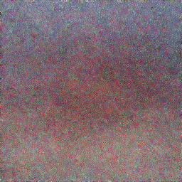

These are the settings of `uv run cgd -gif -freq 3 -size 256 -clip ViT-B/32+PE-Core-B-16 -n 90 -gl 0.99 -cutn 4 "A volcano erupting at night"`, and the GIF is the same as that command's, byte for byte. With `save_frequency=3` it has 31 frames: every third of the 90 steps, then the result. The other keyword arguments are the options' long names, with underscores, and `progress=False` is `--quiet`. A [sequence](#sequences) is a prompt that starts with `>` for each next image, `["A castle", ">A red fox"]`, which is what `|>` splits into.

`cgd.backbone.generate()` is the same with a backbone. With the same settings it makes the same image as the command, byte for byte, so this is the GIF from [Modern backbones](#modern-backbones) again:

```python
from cgd.backbone import generate
from cgd.outputs import save_gif

saved = generate(["A red fox in the snow"], backbone="sd-turbo", num_cutouts=4, save_frequency=1)
frames = [path for batch_index, path in saved]
save_gif(frames, "outputs/A_red_fox_in_the_snow_sd-turbo.gif")
```


## Full Usage - CLI

```sh
usage: cgd [-h] [-imgs IMAGE_PROMPTS] [-size IMAGE_SIZE] [-wd WIDTH_OFFSET]
           [-ht HEIGHT_OFFSET] [-bs BATCH_SIZE] [-seed SEED]
           [-clip CLIP_MODEL] [-fp16] [-cutn NUM_CUTOUTS]
           [-aes AESTHETIC_SCALE] [-best CANDIDATES]
           [-frames TRANSITION_FRAMES] [-dev DEVICE] [-uncond]
           [-thumb {clip,glide,laionide,karlo,none}] [-pag] [-n STEPS]
           [-recur RECURRENCE] [-rate GUIDANCE_RATE] [-gl GUIDANCE_LIMIT]
           [-init INIT_IMAGE] [-skip SKIP_TIMESTEPS] [-is INIT_SCALE]
           [-bb {sd-turbo,vega,sdxl-lightning}] [-iters ITERATIONS]
           [-dir OUTPUT_DIR] [-freq SAVE_FREQUENCY] [-gif] [-mp4] [-up] [-q]
           [prompts]

cgd: make images from text and image prompts with CLIP guided diffusion.

positional arguments:
  prompts               Text prompts, joined with |. Each can take a weight,
                        negative to avoid it: 'a fox:2|blurry:-1'. Begin the
                        next image of a sequence with >, and the GIF or video
                        slides from each image to the next: 'a castle|>a
                        fox|>a sailboat'.

options:
  -h, --help            show this help message and exit
  -imgs, --image-prompts IMAGE_PROMPTS
                        Image prompts, paths or URLs, joined with | and
                        weighted the same way. A sequence of them works the
                        same way too, and image prompts that are not a
                        sequence go with every image of one.
  -size, --image-size IMAGE_SIZE
                        Image size. 64, 128, 256 or 512, default 128. With
                        --unconditional, 256 or 512, default 256. With
                        --backbone, any multiple of 8, defaulting to what the
                        model was trained for.
  -wd, --width-offset WIDTH_OFFSET
                        Make the image this much wider. Default 0.
  -ht, --height-offset HEIGHT_OFFSET
                        Make the image this much taller. Default 0.
  -bs, --batch-size BATCH_SIZE
                        Images to make at once. Default 1.
  -seed, --seed SEED    Random seed. Default 0.
  -clip, --clip-model CLIP_MODEL
                        CLIP model to guide with, one of ViT-B/16, ViT-B/32,
                        RN50, RN101, RN50x4, RN50x16, ViT-L/14,
                        ViT-L/14@336px, PE-Core-B-16, ViT-L-16-SigLIP2-256,
                        PE-Core-L-14-336, ViT-SO400M-16-SigLIP2-384, ViT-
                        gopt-16-SigLIP2-384, PE-Core-bigG-14-448, or a
                        checkpoint file. Join several with + to guide with all
                        of them. Default ViT-B/32, or ViT-B/32+PE-Core-B-16
                        with --unconditional or --backbone. The README has
                        what each costs.
  -fp16, --clip-fp16    Run a PE-Core or SigLIP2 model at half precision: up
                        to 3x faster for half the CLIP VRAM. Less exact, but
                        it scored about the same. OpenAI's models always do.
  -cutn, --num-cutouts NUM_CUTOUTS
                        Random cutouts of the image CLIP sees each step. Fewer
                        is faster and needs less VRAM. Default 16, or 4 with
                        --unconditional.
  -aes, --aesthetic-scale AESTHETIC_SCALE
                        Also reward what people rate highly, per point of a 1
                        to 10 rating. Default 0, or 0.05 with --backbone. The
                        README has what it trades away.
  -best, --candidates CANDIDATES
                        Make this many images from seeds counting up from
                        --seed, and keep the one that CLIP models which did
                        not guide them score best. Takes this many times as
                        long. Default 1.
  -frames, --transition-frames TRANSITION_FRAMES
                        Frames that slide from each image of a sequence to the
                        next, 10 to a second. Default 30, or 60 with
                        --backbone, where a frame is quick.
  -dev, --device DEVICE
                        cpu, cuda or cuda:<index>. Default cuda when there is
                        a GPU.

ImageNet model:
  The default pipeline: CLIP guides OpenAI's ImageNet diffusion model.

  -uncond, --unconditional
                        Draw with an unconditional checkpoint, at 256 or 512,
                        with the settings that made its best images for the
                        time they take: -clip ViT-B/32+PE-Core-B-16 -cutn 4 -n
                        60 -recur 2 -thumb clip. Each of those options
                        overrides its setting. Less reliable than the default,
                        because without an ImageNet class only guidance brings
                        the subject.
  -thumb, --thumbnail {clip,glide,laionide,karlo,none}
                        With --unconditional, a model that reads the noisy
                        image as a 64x64 thumbnail and sets the composition
                        from the text prompts. clip is OpenAI's CLIP of noisy
                        images, glide and laionide are 64x64 text-to-image
                        models, and karlo is one that makes the best images
                        here, for the most VRAM. none leaves the composition
                        to CLIP alone. Default clip, when the image is square
                        and there is a text prompt. The README has what each
                        costs.
  -pag, --perturbed-attention
                        With --unconditional at 256, also move each prediction
                        away from one made with the U-Net's attention switched
                        off. A more finished picture that follows the prompt a
                        little less, for one more model call a step.
  -n, --steps STEPS     Steps down the schedule, a model call each, plus any
                        --recurrence reruns. Default 30, or 60 with
                        --unconditional.
  -recur, --recurrence RECURRENCE
                        Run each guided step in the first 70% of the schedule
                        this many times, taking the image back to the step's
                        noise level in between, so CLIP has more say over the
                        composition. Default 1, or 2 with --unconditional.
  -rate, --guidance-rate GUIDANCE_RATE
                        Guidance strength: the most CLIP may move each step,
                        relative to the noise. Higher follows the prompt
                        harder but saturates. Default 0.08.
  -gl, --guidance-limit GUIDANCE_LIMIT
                        Hold back whatever part of CLIP's update would push
                        more than this quantile of pixels out of range, e.g.
                        0.99. Natural colour and almost no clipped pixels,
                        though the judges prefer the saturated default.
  -init, --init-image INIT_IMAGE
                        Start from this image, a path or URL, instead of pure
                        noise.
  -skip, --skip-timesteps SKIP_TIMESTEPS
                        How much of the 1000 step schedule an init image
                        skips. Higher stays closer to it. Default 500.
  -is, --init-scale INIT_SCALE
                        Also keep the image perceptually close to the init
                        image, by LPIPS, e.g. 1000. Default 0.

Modern backbones:
  Draw with a one-step model and correct it with CLIP by optimising its
  noise, instead of guiding the ImageNet model. The best images this makes.

  -bb, --backbone {sd-turbo,vega,sdxl-lightning}
                        The model to draw with.
  -iters, --iterations ITERATIONS
                        Steps of noise optimisation. 0 is the plain model.
                        Default 50.

Output:
  -dir, --output-dir OUTPUT_DIR
                        Where images go, in a folder named after the prompts.
                        Default outputs.
  -freq, --save-frequency SAVE_FREQUENCY
                        Save a frame every this many steps. The result is
                        always saved. Default 10, or 1 with --gif or --mp4.
  -gif, --gif           Also save the frames as a GIF, then delete them. A
                        sequence does unless it asks for --mp4.
  -mp4, --mp4           Also save the frames as an H.264 video, then delete
                        them.
  -up, --upscale        Also save a copy 4x larger, made with Real-ESRGAN
                        x4plus. Adds little time or VRAM.
  -q, --quiet           No progress bars or status messages.
```

## Development

```sh
git clone https://github.com/afiaka87/clip-guided-diffusion.git
cd clip-guided-diffusion
uv sync
```

### Tests

```sh
uv run pytest tests/unit  # Seconds, on the CPU.
uv run pytest             # Everything, in about three and a half minutes on an RTX 4070.
```

- `tests/unit` checks the pure parts on small inputs: the sampler on data whose exact answer is known, the cutouts, losses, the noise optimisation, tiling, prompts and the command line.
- `tests/integration` runs the real models on a GPU for a few steps each, and skips without one. Give them a free one: they fail with a genuine out of memory error if another process holds the VRAM.
- `uv run ruff check`, `uv run ruff format --check` and `uv run pylint cgd tests` should all pass.
