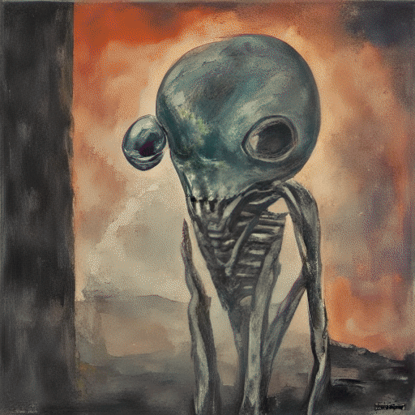
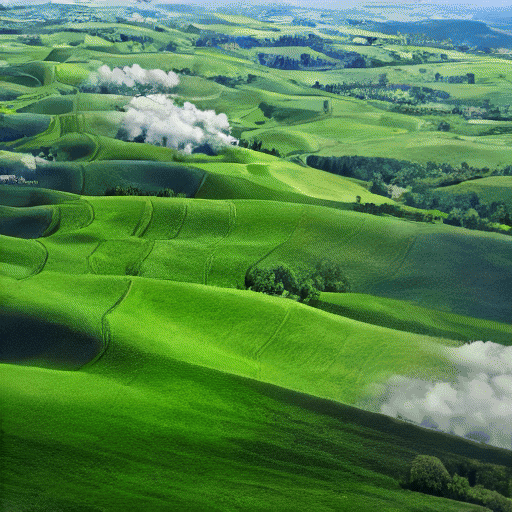
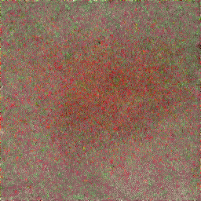
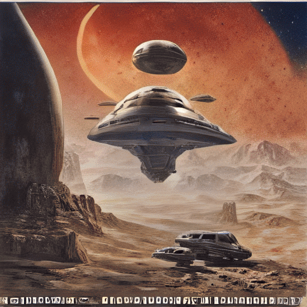
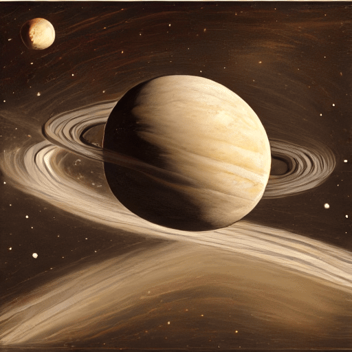
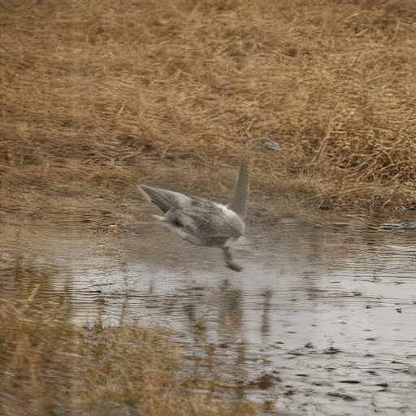

# Generations

Each GIF is its command's real output. Most use [a modern backbone](/README.md#modern-backbones), with `-freq 5` to keep every fifth step.

`uv run cgd -bb sd-turbo -gif "Alien friend by Odilon Redo"`

`uv run cgd -gif -freq 5 -bb sd-turbo "Rolling green hills under a blue sky with white clouds, Windows XP wallpaper"`

`uv run cgd -gif -freq 3 -size 256 -clip ViT-B/32+PE-Core-B-16 -n 90 -gl 0.99 "A mushroom in a mossy forest, 8K HDR photograph"`

`uv run cgd -gif -freq 5 -bb sd-turbo "A city street at dusk, photo taken on Kodak Portra 400"`

`uv run cgd -gif -freq 5 -bb sd-turbo "A spaceship over a desert planet, 1980s science fiction movie poster"`

`uv run cgd -gif -freq 5 -bb sd-turbo --seed 1 "The planet Saturn|zoomed out:-0.3"`

Penalizing `zoomed out`. Seed 1 came in closest. Seed 0 drew the whole planet, over a caption strip of nonsense text.

`uv run cgd -gif -freq 5 -bb sd-turbo "A goose running across a field"`

`uv run cgd -gif -freq 5 -bb sd-turbo "A golden retriever looking at the camera"`

`uv run cgd -gif -freq 5 -bb sd-turbo "A glass sphere resting on a mirror"`
